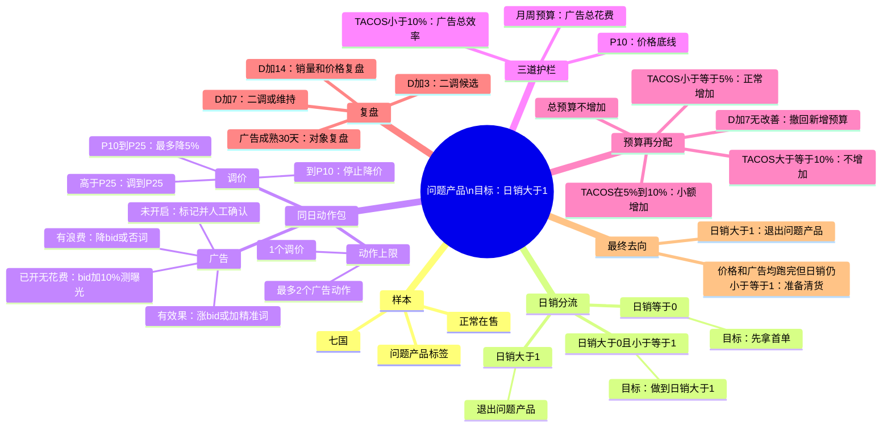

# 问题产品策略思维导图



## 文字版

```text
问题产品
└─ 目标：日销 >1
   ├─ 日销 =0：先拿首单
   ├─ 0<日销≤1：继续拉销量
   └─ 日销 >1：退出问题产品

日销≤1时：生成同日动作包
├─ 调价
│  ├─ P>P25：调至P25
│  ├─ P10<P≤P25：最多降5%
│  └─ P≤P10：停止降价
├─ 广告
│  ├─ 未开启：标记并人工确认
│  ├─ 已开无花费：bid+10%测曝光
│  ├─ 有浪费：降bid/否词
│  └─ 有效果：涨bid/加精准词
└─ 收口：1个调价 + 最多2个广告动作

护栏
├─ 价格不低于P10
├─ 产品TACOS<10%
└─ 不超过月/周预算与总预算池

预算
├─ 总预算不增加，只做内部再分配
├─ TACOS≤5%：正常增加
├─ 5%<TACOS<10%：小额增加
└─ TACOS≥10%或无成熟订单：不增加

复盘
├─ D+3：二调候选
├─ D+7：二调/维持；预算无效则撤回
├─ D+14：价格与销量复盘
└─ 广告成熟30天：复盘具体广告对象

最终去向
├─ 日销>1：退出问题产品
└─ 已到P10 + 价格D+14完成 + 广告30天完成 + 日销≤1
   └─ 标记“准备清货”，移交后续清货角色
```
