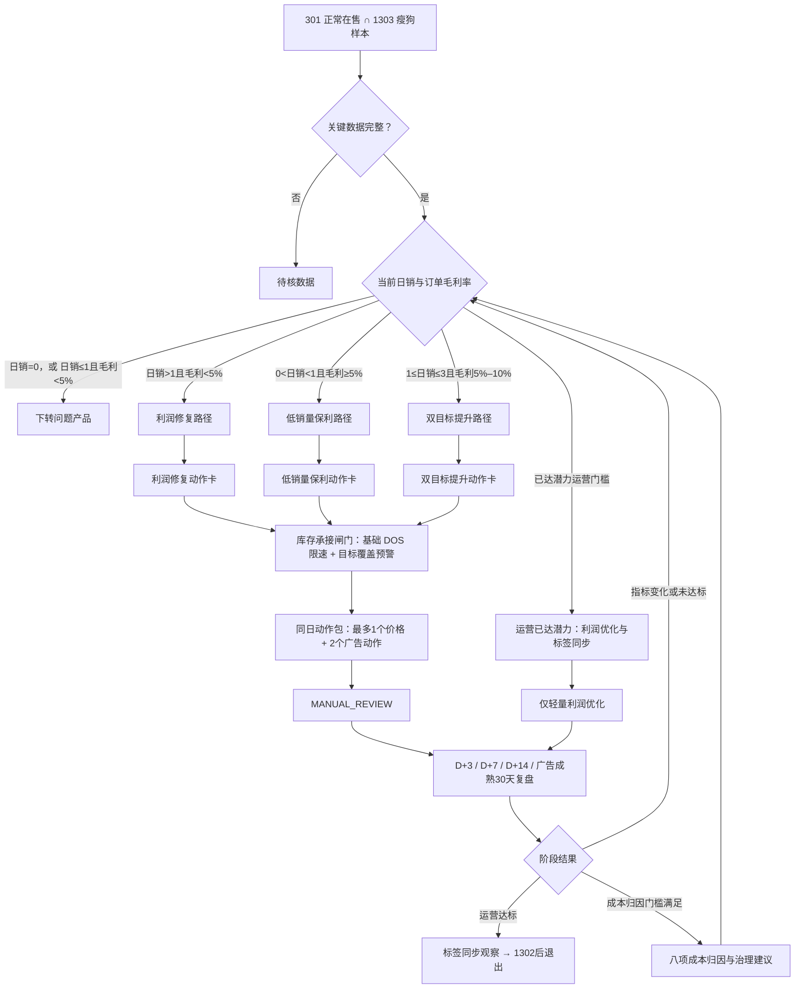

# 七国瘦狗产品可复用运营决策框架

## 自动广告调整对象确认（2026-09-30）

本方案自动广告的升bid、降bid和零花费曝光测试，均以四种匹配方式对应的投放目标为对象：紧密匹配、宽泛匹配、同类商品、关联商品。每个目标分别判断，不以整个广告组作为这四种方式的竞价调整对象。此处只明确对象与取数口径，原有阈值、幅度、库存预算及审核条件继续适用。

- 唯一动作键为`profile_id + campaign_id + ad_group_id + target_id`。从`ods_datasync.lx_advertising_sp_targets`取实体，限定`expression_type='auto'`，以`expression`识别方式：`queryHighRelMatches`为紧密、`queryBroadRelMatches`为宽泛、`asinSubstituteRelated`为同类、`asinAccessoryRelated`为关联；未知类型待核。
- 当前有效竞价：目标`bid > 0`取自身值；目标`bid`为空或0时，按`profile_id + campaign_id + ad_group_id`关联`ods_datasync.lx_advertising_sp_ad_groups`，取同组有效`default_bid`。默认值也缺失或无效、关联不唯一时待核；不能把空值或0作为零出价。
- 点击、订单、花费和销售额取该目标自身同一成熟窗口的数据，并从汇总值计算ACOS、CVR。若用搜索词日报回卷，须去重、按完整目标键汇总，并核验归属、完整窗口、币种及与同组同窗数据对账。不能将广告组汇总复制或平均分配给四个目标；缺少可靠目标表现时不输出数值竞价建议。
- `dws_sp_search_term_analysis_daily.default_bid_current`只是广告组默认竞价。该表当前没有目标独立bid字段；`match_type`也不能直接当作四种自动方式。使用其target_id定位目标后，仍须取目标实体及有效竞价，不能沿用旧宽表建议。
- 建议价写到具体`target_id`，不修改广告组默认bid，也不把一个目标命中扩展成四种方式同时调整。继承默认bid的目标调整后设置目标独立bid；撤回时恢复原独立值或原继承状态，不将旧默认值固定为独立bid。
- 结果至少保存完整动作键、匹配方式及expression、目标原bid、组默认bid、有效bid及来源（own/group_default）、数据日期和成熟窗口、目标表现、规则码、建议bid、实际变化率及拦截原因。核验活动、组、目标启用和产品归属；不得用`object_type=ad_group`、缺失匹配方式的记录冒充目标级建议。

文档明确不代表生产生成逻辑已同步，须以结果中的目标标识、竞价来源和目标表现逐条验收。

## 毛利口径统一（2026-09-30确认）

问题产品、瘦狗产品和潜力产品的经营分流、调价、广告准入、路径切换及效果复盘统一使用**订单毛利率**。本文未单独限定的“毛利”“实际毛利”“margin”均指订单毛利率，不使用结算毛利率替代。

- 数据来自同一层、同一版本的产品表现日表；当前 DWD 为 `dwd_datasync.lx_statistics_product_performance`，订单毛利润字段为 `predict_gross_profit`，销售额字段为 `amount`。需要 ODS 复核时通过 `dwd.relate_id = ods.id` 对齐，不混拼两层金额。
- 经营分流使用最近完整 30 天：`订单毛利率 = sum(predict_gross_profit) / sum(amount)`；按国家＋店铺＋MSKU、同一窗口、同一币种汇总。日销为同窗口 `sum(volume) / 30`。
- 保留零销量日的订单毛利润及负值；不平均每日 `predict_gross_margin`，不再减一次广告费；`sum(amount) <= 0` 或必要数据缺失时输出待核，不当作零毛利率。
- 3/7/14 天等复盘保留原有窗口长度，但每个窗口均使用上述订单毛利率公式。阈值 5%/10% 等在计算中使用 0.05/0.10；标签 JSON 的百分数值须除以 100。
- `gross_profit`、`gross_margin` 属于结算口径，不参与本策略毛利判断；成本快照只用于成本项诊断，不能替代订单毛利率来源。P5/P10/P15/P20/P25/P30 等仍是定价模型价格线，不等于实际订单毛利率或调价后保证达到的毛利率。
- 本次统一毛利指标，不改变已确认的价格档位、调价幅度、库存、预算和历史动作约束；文档更新不代表生产计算已同步。

## 1. 框架目的与边界

本框架的目标是将瘦狗产品逐步提升至潜力产品，而不是为了销量无条件降价或加广告。日销和订单毛利率是同级目标：提升销量的动作不得突破利润护栏；毛利不足时，先修复利润，再恢复扩量。

适用范围固定为 DE、FR、IT、ES、NL、UK、US 七国，决策粒度固定为“国家 + 店铺 + MSKU”。每次运行仅处理：

```text
标签 301（正常在售，current）按 店铺 + MSKU 命中
AND
标签 1303（站点瘦狗产品，30d）按 国家 + 店铺 + MSKU 命中
AND
国家属于七国
```

排名不参与本框架的动作、预算或运营达标判断。它只可能影响后续标签是否实际从 `1303` 更新为 `1302`，因此只作为标签同步观察字段保留。

本框架只输出 `MANUAL_REVIEW` 建议，不直接写入售价、广告平台、活动预算或标签表；也不修改既有 `1303`、`1302` 标签规则。

## 2. 目标、成功定义与不可突破的约束

### 2.1 双层成功

| 层级 | 判定 | 后续处理 |
|---|---|---|
| 运营达标 | `1≤日销≤3` 且订单毛利率 `≥10%`，或日销 `>3` 且订单毛利率 `≥5%` | 标记“运营已达潜力”，停止激进拉量，继续利润优化与标签同步观察。 |
| 标签升级 | 最新可比标签为 `1302` 站点潜力产品 | 退出瘦狗动作池，移交潜力产品后续框架。 |

运营达标但标签仍为 `1303` 不视为失败：保留在瘦狗样本内做轻量利润优化，并输出“运营达标、标签未同步”的证据。该状态不再自动降价、主动加预算或进行激进 bid 扩量。

### 2.2 主指标与护栏

| 类型 | 指标与口径 | 用途 |
|---|---|---|
| 角色目标 | 最近完整 30 天日销、30 天订单毛利率 | 判断是否运营达潜力或下转问题产品。 |
| 早期效果 | 同口径 7 天日销、广告订单、CVR、ACOS、TACOS | 判断动作包是维持、收缩还是受控扩量。 |
| 定价护栏 | 当前价、P30、P15；利润修复额外使用 P5、P10 | P30 是高价下调上限；P15 是自动降价底线，也是利润修复提价的最终上限。 |
| 预算护栏 | 月/周预算、未来基础消耗后的可用余额、共享活动归因 | 只能做总预算池内再分配。 |
| 库存承接 | FBA 可售、库存快照日期、基础 DOS、目标覆盖 DOS、在途、库龄 | 基础 DOS 决定首轮拉量动作是卡住、放缓、受控还是正常执行；目标覆盖 DOS 只提示成功后的补货风险。 |

硬约束：

- 自动降价仅在 P30–P15 区间内调整：高价最多下调至 P30，任何自动降价不得低于 P15；利润修复提价则仅按 P5→P10→P15 阶梯逐档上调。
- 站点/国家广告总预算不得增加或突破；可加预算必须来自释放预算或扣除未来基础消耗后的未分配余额。
- 库存仅限制会拉高销量的动作（降价、涨 bid、加精准词、曝光测试、预算迁移/增加）；降 bid、否词、暂停、预算回收、提价和成本核验不受库存闸门限制。
- 价格、P15、订单毛利率、广告实体、预算或成熟广告表现等关键字段缺失时，输出“待核数据”，不得输出伪精确数值动作。
- 每条记录最多输出 1 个价格动作和 2 个广告原子动作；否词、降 bid、暂停等风险收缩动作优先。

## 3. 数据闸门与标签/指标冲突

| 状态 | 条件 | 允许输出 |
|---|---|---|
| 可执行 | P30/P15、订单毛利率、广告实体、成熟表现与预算状态完整；利润修复提价时另须 P5/P10 完整 | 生成数值化价格、bid 或预算建议。 |
| 候选待复核 | 方向可判断，但广告尚未成熟、共享活动分摊不清、当前花费未同步或映射不唯一 | 只输出候选方向和阻断原因。 |
| 待核数据 | 关键价格线异常、订单毛利率缺失、预算冲突或来源过期 | 不生成价格、扩量或预算数值。 |

若产品仍命中 `1303`，但当前实际指标与瘦狗常规口径不一致（例如日销 `>1` 且毛利 `<5%`），仍纳入框架，按当前日销/毛利进入对应路径，并输出 `标签/指标冲突`。不因标签滞后静默排除该记录。

## 4. 运营主流程：先选路径，再按动作卡执行



后面的价格、广告、预算与成本章节不是另一套流程，而是下面三张动作卡调用的细则：价格看 5.1，成本看 5.2，广告、预算和库存承接看第 6 节。运营执行时只需先找到当前路径，再按卡片的时间顺序走。

三条路径共用同一条 D+3 规则：只核验价格和广告动作是否实际生效、是否出现异常波动，不因为短期销量或 ACOS 波动立即加大动作；路径切换、预算撤回和成本归因均从 D+7 以后判断。

### 4.1 三条路径动作卡

#### 4.1.1 利润修复：价格没有空间后，依次处理广告与成本

**进入条件：** 日销 `>1` 且订单毛利率 `<5%`。目标是把订单毛利率恢复到 `≥5%`，不牺牲已有销量。

| 如果当前状态是… | 同日要做什么 | 复盘出口 |
|---|---|---|
| `P<P15` | 按 5.1 的利润修复定价阶梯直接提至下一档：`P<P5 → P5`、`P5≤P<P10 → P10`、`P10≤P<P15 → P15`；若同时存在广告浪费，仍可同日降 bid/否词/暂停。禁止涨 bid、加精准词、加预算。 | D+7 看日销是否受提价影响、毛利是否回升；未到 P15 时才允许下一轮升至下一有效定价档位。 |
| `P≥P15` 且 `TACOS>5%` | 不调价；广告动作只选降 bid、否词、暂停、预算回收。 | D+7 看 TACOS 是否降至 `≤5%`、毛利是否回升；未受控前不进入成本结论。 |
| `P≥P15` 且 `TACOS≤5%` | 不再提价、不扩量；发起八项成本数据核验。 | D+7 仍毛利 `<5%` 且成本快照合格，成为成本归因候选；D+14 / 广告成熟 30 天后正式执行 5.2。 |
| 日销降为 `0`，或日销 `≤1` 且毛利 `<5%` | 停止瘦狗动作包。 | 下转问题产品。 |
| 毛利恢复 `≥5%` | 不再沿用利润修复动作。 | 按最新日销切到低销量保利、双目标提升或运营已达潜力。 |

#### 4.1.2 低销量保利：先由广告效率决定能否拉量，再把日销推到 1

**进入条件：** `0<日销<1` 且订单毛利率 `≥5%`。目标是稳定达到日销 `≥1`，不是用降价换取短期销量。

本路径中的降价、涨 bid、加精准词、曝光测试和预算测试均须先通过 6.7 的基础 DOS 闸门；目标覆盖 DOS 不阻断首轮动作，但会提示达到日销 1 后的补货风险并限制后续扩量。毛利 `5%–10%` 的目标是先通过广告把日销拉到 1，不自动用降价拉量；当前价格判断已与广告状态合并如下：

| 当前价格 + 广告状态 | 同日要做什么 | 复盘出口 |
|---|---|---|
| 毛利 `5%–10%`、`P>P30`、有花费且 `TACOS≤5%` | 不自动降价、不加预算；**同日进入 5.2 成本诊断**，先核验八项成本快照。若存在通过第一档效率门槛的自动/手动现有对象，仅对其中 1 个 bid `+5%`，做 7 天销量测试。 | D+7：同步输出成本诊断结论；日销未改善、毛利跌破 `5%` 或 TACOS 恶化则撤回 `+5%`。改善则维持至 D+14，不连续加价。 |
| 毛利 `5%–10%`、`P15<P≤P30`、有花费且 `TACOS≤5%` | 维持价格、不加预算；若存在通过第一档效率门槛的自动/手动现有对象，仅对其中 1 个 bid `+5%`，做 7 天销量测试。 | D+7：日销未改善、毛利跌破 `5%` 或 TACOS 恶化则撤回 `+5%`；改善则维持至 D+14，不连续加价。 |
| 毛利 `5%–10%`、`P≤P15`、有花费且 `TACOS≤5%` | 不得降价换量、不加预算；若存在通过第一档效率门槛的自动/手动现有对象，仅对其中 1 个 bid `+5%`，做 7 天销量测试。 | D+7：日销未改善、毛利跌破 `5%` 或 TACOS 恶化则撤回 `+5%`；改善则维持至 D+14，不连续加价。 |
| 毛利 `5%–10%`、`P>P30`、有花费且 `TACOS>5%` | 不自动降价、不涨 bid、不加预算；**同日进入 5.2 成本诊断**，并做降 bid、否词、暂停、预算回收等止损。 | D+7 同步输出成本诊断结论及止损后 TACOS；毛利仍 `≥5%`、日销未到 1 时留在本路径。 |
| 毛利 `5%–10%`、`P15<P≤P30`、有花费且 `TACOS>5%` | 维持价格；不涨 bid、不加预算，仅做降 bid、否词、暂停、预算回收等止损。 | D+7 / D+14 看止损后 TACOS 与日销；毛利仍 `≥5%`、日销未到 1 时留在本路径。 |
| 毛利 `5%–10%`、`P≤P15`、有花费且 `TACOS>5%` | 不得降价换量；不涨 bid、不加预算，仅做降 bid、否词、暂停、预算回收等止损。 | D+7 / D+14 看止损后 TACOS 与日销；毛利仍 `≥5%`、日销未到 1 时留在本路径。 |
| 毛利 `5%–10%`、`P>P30`、已开但 30 天无花费 | 不自动降价、不加预算；**同日进入 5.2 成本诊断**。预算与基础 DOS 通过时，对 1 个已启用、可映射的现有对象 bid `+5%`，做 7 天曝光/销量测试。 | D+7 同步输出成本诊断结论；无曝光、点击或花费时不连续抬 bid，输出实体、预算、库存或映射待核；有花费后再按 TACOS 路由。 |
| 毛利 `5%–10%`、`P15<P≤P30`、已开但 30 天无花费 | 维持价格、不加预算；预算与基础 DOS 通过时，对 1 个已启用、可映射的现有对象 bid `+5%`，做 7 天曝光/销量测试。 | D+7 无曝光、点击或花费时不连续抬 bid，输出实体、预算、库存或映射待核；有花费后再按 TACOS 路由。 |
| 毛利 `5%–10%`、`P≤P15`、已开但 30 天无花费 | 不得降价换量、不加预算；预算与基础 DOS 通过时，对 1 个已启用、可映射的现有对象 bid `+5%`，做 7 天曝光/销量测试。 | D+7 无曝光、点击或花费时不连续抬 bid，输出实体、预算、库存或映射待核；有花费后再按 TACOS 路由。 |
| 毛利 `≥10%` 且 `P>P30` | 直接调至 P30；满足第 6 节对象级扩量条件时，可同日附加广告动作。 | D+7 看价格生效后的日销、毛利与 TACOS；不达标则撤回新增预算或按规则收缩。 |
| 毛利 `≥10%` 且 `P15<P≤P30` | 执行 `max(P×95%, P15)` 的受控降价；仅在 `TACOS<10%`、预算可用、对象级规则通过时，同日执行 bid `+8%/+15%/+20%` 或预算测试。 | D+7 判断是否维持或撤回；广告成熟 30 天后确认对象是否有效。 |
| 毛利 `≥10%` 且 `P≤P15` | 不再降价；只保留符合第 6 节条件的有效广告测试及广告止损。 | 日销未提升则不以成本归因替代拉销量，继续按广告成熟表现复盘。 |
| 日销达到 `≥1` | 结束低销量保利动作。 | 毛利 `5%–10%` 转双目标提升；日销 `1–3` 且毛利 `≥10%`，或日销 `>3` 且毛利 `≥5%`，转运营已达潜力。 |
| 日销变为 0，或日销 `≤1` 且毛利 `<5%` | 停止瘦狗动作包。 | 下转问题产品。 |

#### 4.1.3 双目标提升：先看广告效率，合格才给受控扩量，稳定后再查成本

**进入条件：** `1≤日销≤3` 且订单毛利率 `5%–10%`。目标是日销 `>3`、订单毛利率 `≥10%`。

本路径中的 bid 上调、加精准词、净额预算迁移和 `B_test` 均须先通过 6.7 的基础 DOS 闸门；目标覆盖 DOS 不会把所有产品直接按日销 3 卡住，只用于后续补货预警和第二轮扩量限制。

| 如果当前状态是… | 同日要做什么 | 复盘出口 |
|---|---|---|
| `TACOS>10%` | 不调价、不扩量；只做降 bid、否词、暂停或预算回收。 | D+7 看 TACOS 是否回落至 `≤10%`、毛利是否改善；恢复前不进入预算测试。 |
| `5%<TACOS≤10%` | 不调价、不新增预算、不加精准词；先做降 bid/否词/暂停回收低效花费。仅当同一 MSKU 已回收等额花费、且高效对象通过第一档效率门槛时，可对 **1 个现有对象** bid `+5%`。 | 这是净额迁移而非扩量；D+7 日销未改善、毛利下降或 TACOS 恶化，撤回该 `+5%`。 |
| `TACOS≤5%`，但没有通过第一档对象效率门槛 | 保持价格 `≥P15`，不加预算、不涨 bid；允许保留必要的广告止损。 | 广告成熟 30 天后再判断对象能否进入第一档。 |
| `TACOS≤5%`，预算可用，且对象满足点击 `≥10`、订单 `≥2`、`ACOS≤30%`、`CVR≥8%` | 保持价格 `≥P15`；同日执行 bid `+8%`，月/周预算测试最多 `B_test×50%`。 | D+7 若日销未改善、毛利下降或 TACOS 恶化，撤回本轮新增 bid/预算。 |
| 价格已在 `P15–P30`、销量和广告均稳定、毛利仍 `<10%` | 停止进一步扩量和自动调价。 | D+14 / 广告成熟 30 天后进入 5.2 八项成本归因。 |
| 毛利跌 `<5%` | 停止双目标扩量。 | 切换至利润修复。 |
| 日销回落到 `0<日销<1` 且毛利 `≥5%` | 停止双目标扩量。 | 切换至低销量保利。 |
| 日销 `>3` 且毛利 `≥5%`，或日销 `1–3` 且毛利 `≥10%` | 停止激进拉量。 | 标记运营达潜力，等待标签升为 `1302`。 |

产品进入“运营已达潜力”状态后，只保留降 bid、否词、预算回收、价格/利润异常修复等轻量动作；不自动降价、加预算、涨 bid 或加精准词，直至标签实际升为 `1302` 或指标重新跌回相应路径。

### 4.2 路径切换与下转问题产品

下转只在以下条件发生：

1. 日销变为 `0`；或
2. 日销 `≤1` 且订单毛利率 `<5%`。

日销 `>1` 且毛利 `<5%` 不自动下转，而是持续处于利润修复路径。日销从 `1–3` 回落到 `0<日销<1`、但毛利仍 `≥5%` 时，转入低销量保利路径，而不是问题产品。

## 5. 同日动作包与价格规则

调价与广告是一个同日动作包，不是“先调价、失败后再投广告”的串行关系：

```text
同一数据快照
  → 校验 P30、P15 与订单毛利率
  → 确定价格动作或不动作
  → 先判广告状态：未开启 / 映射待核 / 零花费 / 有花费但浪费或有效
  → 再按毛利分层与广告对象类型选择收缩/扩量动作
  → 校验 TACOS、预算、广告对象表现、基础 DOS 与目标覆盖 DOS
  → 输出 1 个价格动作 + 最多 2 个广告动作
  → 人工审核后同一批次执行
```

### 5.1 P30/P15 降价边界与利润修复提价阶梯

设当前价格为 `P`。P30、P15 分别为定价模型在 30%、15% 毛利目标下的价格线；金额按站点币种精度向上取整。瘦狗产品的降价只使用 P30 与 P15；利润修复提价额外使用 P5、P10、P15 的模型定价阶梯，不能按当前价格百分比任意提价。

| 条件 | 建议价格动作 | 说明 |
|---|---|---|
| 日销 `≤1` 且订单毛利率 `<5%` | 不生成瘦狗价格动作 | 下转问题产品，由问题产品框架处理。 |
| 日销 `>1`、订单毛利率 `<5%` 且 `P<P5` | 直接提至 `P5` | 仅利润修复路径；当前价格低于最低可用修复档时，先回到 P5，不按当前价比例计算。 |
| 日销 `>1`、订单毛利率 `<5%` 且 `P5≤P<P10` | 直接提至 `P10` | 当前价已归属 P5 档，下一轮直接跳至 P10。 |
| 日销 `>1`、订单毛利率 `<5%` 且 `P10≤P<P15` | 直接提至 `P15` | 当前价已归属 P10 档，下一轮直接跳至 P15；P15 是利润修复提价的最终上限。 |
| 日销 `>1`、订单毛利率 `<5%` 且 `P≥P15` | 不自动调价 | 先处置 `TACOS>5%` 的广告浪费；若广告已受控且毛利仍低，进入 5.2 成本归因，不基于模型线无依据加价。 |
| `0<日销≤3` 且订单毛利率 `5%–10%` | 不自动降价 | 覆盖低销量保利与双目标提升路径；价格分档见 4.1.2：`P>P30` 直接进入 5.2 成本诊断，`P15<P≤P30` 维持价格，`P≤P15` 不得降价；价格、广告稳定后毛利仍未提升时，也进入 5.2 成本归因。 |
| `0<日销<1`、订单毛利率 `≥10%` 且 `P>P30` | 直接调至 P30 | 仅低销量保利路径可做价格竞争力修复；不直接跨越 P30 降向更低价格线。 |
| `0<日销<1`、订单毛利率 `≥10%`、`P15<P≤P30` 且需受控测试 | `max(P×95%, P15)` | 每轮最多降 5%，不得突破 P15。 |
| 已达潜力运营门槛 | 不自动调价 | 停止激进拉量，仅做利润异常修复和标签同步观察。 |
| P30/P15 缺失、反向或异常 | 待核数据 | 不输出任何数值调价。 |
| 利润修复需提价，但 P5/P10/P15 任一缺失、反向或当前价无法归属 | 定价阶梯待核 | 不用 `P×百分比` 或其他价格线替代提价。 |

P15 是瘦狗自动降价的唯一价格下限；P30 是高价下调上限。利润修复的提价顺序固定为 `P5 → P10 → P15`，P15 也是提价最终上限。P15 或 P30 缺失时，系统不得使用其他价格线替代执行自动调价；利润修复的 P5/P10/P15 阶梯缺失或异常时，系统不得输出数值提价。

所有会降低售价的动作还须通过 6.7 的基础 DOS 闸门：库存不足时不因价格仍有空间继续降价；提价、维持价格和广告止损不受该闸门限制。

### 5.2 价格与销量已基本合适，或高价但低毛利：全成本诊断

这一分支不是又一次调价。它通常处理“销量已有基础、价格在 P15–P30 的合理区间、广告已受控，但订单毛利率仍未达到路径目标”；也处理“`0<日销<1`、毛利 `5%–10%`、价格 `P>P30`”的异常组合：售价已高于竞争力上限但毛利仍低，优先核验是否由采购、物流、FBA、佣金、税费、广告或退款等成本项吃掉利润。此时继续降价会扩大毛利缺口，继续提价又可能损失已获得的销量；应先判断是否真由成本造成缺口，再定位到具体成本项。

成本归因通常最早在同日动作包后的 D+7 发起候选判断，在 D+14 或广告归因成熟 30 天时形成正式建议；但上述“高价但低毛利”组合在同日即发起八项成本快照核验，并在 D+7 输出诊断结论。它不占用“1 个价格动作 + 2 个广告动作”的额度，但所有结果均为 `MANUAL_REVIEW`：不直接改采购价、物流、费用设置或售价。

#### 5.2.1 先看结论：成本诊断判定卡

运营人员按下表从上至下判断，命中一个结论即执行对应下一步；不需要先阅读公式。纵向异常是当前可以独立使用的证据；横向同类比较仍是暂定增强项，缺失时不阻塞判断。

| 判断顺序 | 必须满足的条件 | 输出结论 | 后续应做什么 |
|---|---|---|---|
| 1. 是否该查成本 | 利润修复：日销 `>1`、毛利 `<5%`、`P≥P15`、`TACOS≤5%`，D+7 后毛利仍 `<5%`；或双目标：日销 `1–3`、毛利 `5%–10%`、`P15≤P≤P30`、`TACOS≤5%`，D+14 后毛利仍 `<10%`；或低销量异常：`0<日销<1`、毛利 `5%–10%`、`P>P30` | 进入成本诊断 | 低销量异常同日核验八项成本快照，D+7 输出诊断结论；其余情形计算毛利缺口并核验成本数据。 |
| 2. 是否可以下结论 | 统计期一致；成本/对账状态可用；最终对账差异为 0（或允许舍入误差）；八项成本和净销售额非空、非负 | 成本数据可用 | 继续判断纵向变化；任一条件不满足则输出“成本数据待核”，停止归因。 |
| 3. 是否有近期成本主因 | 某成本项连续 `3` 个有效自然日同向上升，且每天都满足“变化 `≥20%` 且 `≥1 CNY/件`” | 突发成本变动待核 | 按成本项核验批次、费率、账单或录入；见 5.2.4 的责任动作。 |
| 4. 是否有长期结构性主因（暂定） | 同类可比字段、样本量均已核验，且某成本项超额 `≥` 毛利缺口的 `30%` | 长期结构性偏高 | 建立该成本项的人工治理单；如同时命中第 3 步，标“高置信成本主因”。 |
| 5. 均未命中 | 无强上升异常；或横向基准暂不可用/未达 30% | 未发现成本主因 | 不把成本当作调价理由；回到对应路径继续利润、价格或广告复盘。 |
| 特殊：强下降波动 | 某成本项连续 `3` 个有效自然日同向下降，且每天均为异常候选 | 正向变动待核 | 核对结算、供应商/物流变化或退款入账；不据此自动降价、加预算或扩大广告。 |

以下情况**不进入**成本诊断：`0<日销<1` 且毛利 `≥10%`（先做销量提升）；`TACOS>5%` 或广告未成熟（先做广告止损/成熟复盘），**但**“`0<日销<1`、毛利 `5%–10%`、`P>P30`”的高价低毛利组合为例外，仍进入成本诊断；日销 `>1`、毛利 `<5%` 且 `P<P15`（先按 5.1 完成一次定价阶梯提价并复盘）；日销为 0，或日销 `≤1` 且毛利 `<5%`（下转问题产品）。

#### 5.2.2 诊断数据与公式细则

订单毛利润及销售额另取同一窗口、同一币种的产品表现日表 `predict_gross_profit`、`amount`；下述成本快照仅提供成本分项和对账信息。成本金额不能直接替代订单毛利润，无法同口径对齐时标记待核，不将成本分项与订单毛利缺口强行相减归因。

成本来源固定为 `temporary_dwd` 的“产品近 30 天八项成本每日快照 V4”（物理表为“近 30 天全项成本每日快照 V4”），按国家 + 店铺 + MSKU 对齐产品 30 天指标。包含采购、头程、FBA、佣金、税费、广告、退款/退货、仓储及其他调整、成本状态和最终对账差异；金额统一换算为 CNY，避免跨站点币种直接比较。

```text
目标毛利率 = 利润修复路径 5%；双目标提升路径 10%
订单毛利缺口(CNY) = max(0, 目标毛利率 × 近30天销售额 − 近30天订单毛利润)

单位成本_t(CNY/件) = 成本项_t(CNY) ÷ 近30天销量_t
相对变化率_t = (单位成本_t − 单位成本_t−1) ÷ abs(单位成本_t−1)
单件绝对变化_t(CNY/件) = 单位成本_t − 单位成本_t−1
波动影响额(CNY) = abs(单件绝对变化_t) × 当期近30天销量_t
```

纵向比较只看单位成本，不看成本总额，避免把销量变化误判成成本异常。有效日必须为相邻自然日，且两日近 30 天销量均大于 0、八项成本完整、成本/对账状态可用、最终对账差异为 0（或允许舍入误差）。前日单位成本为 0、日期断档或任一日数据不合格时，不计算变化率，也不能把后续日期拼成连续 3 日。

| 纵向阈值 | 标记 | 用途 |
|---|---|---|
| 相对变化绝对值 `<10%`，或前序快照不可比 | 正常/无足够证据 | 不做成本归因。 |
| `10%–<20%` | 成本波动观察 | 只记录，不生成责任动作。 |
| `≥20%` 且单件绝对变化绝对值 `≥1 CNY/件` | 成本异常候选 | 记录方向、金额、成本项。 |
| 同一成本项连续 `3` 个有效自然日同向上升，且每天均为候选 | 强成本上升异常 | 命中判定卡第 3 步。 |
| 同一成本项连续 `3` 个有效自然日同向下降，且每天均为候选 | 强成本下降波动 | 命中特殊分支，先核验。 |

`10% / 20% / 1 CNY / 连续 3 日` 沿用此前问题产品的成本异常标注口径；它只说明变化异常，不单独证明已造成当前毛利缺口。

#### 5.2.3 横向同类比较：暂定增强项

横向比较只用于识别“长期比同类贵”，不用于替代纵向异常。暂定基准为“同国家 + 同店铺 + 同品类 + 同价格带”的 `301/current ∩ 1302/30d` 运营达标产品，样本至少 10；不足时才考虑“同国家 + 同品类 + 同价格带”、样本至少 30 的弱基准。**同品类、价格带、尺寸重量等可比字段是否可得尚未确认，因此本项不是当前必需数据。**

```text
成本项率 = 某成本项(CNY) ÷ 近30天净销售额
成本项超额(CNY) = max(0, 本品成本项率 − 同类基准P50成本项率) × 本品近30天净销售额
毛利缺口覆盖率 = 成本项超额 ÷ 毛利缺口
```

只有可比池和字段验证通过后，才计算成本项超额。覆盖率 `≥30%` 才进入主要归因候选，最多输出前 2 项；不足 30% 仅保留观察。横向结果与纵向结果分别输出，不能相加后重复计算节省金额：横向达标且纵向强上升为“高置信成本主因”；仅横向达标为“长期结构性偏高”；仅纵向强上升为“突发成本变动待核”。

#### 5.2.4 已定位后，按成本项派发人工动作

| 命中的成本项 | 应核验的证据 | 输出的人工治理动作 | 不应做的事 |
|---|---|---|---|
| 采购 | 供应商报价、采购批次、物料/包装变更、BOM | 建采购降本责任人与目标金额。 | 不直接把采购异常归因于售价，或直接改采购价。 |
| 头程 | 运输方式、计费重/体积重、发货批次、路线 | 评估合箱、包装减重、发运节奏。 | 不以压 bid 或降售价替代头程治理。 |
| FBA | 尺寸重量、包装、费率档、货件分仓、FBA 拆分 | 提交物流/财务复核差异。 | 不直接视为广告低效。 |
| 佣金或税费 | 类目、费率、税务主体、结算规则 | 由财务确认后处理。 | 不自行修改税费或平台费率。 |
| 广告 | 高 ACOS 对象、搜索词和预算消耗 | 回到第 6 节做降 bid、否词、暂停或预算回收。 | `TACOS>5%` 未处理时，不转去解释其他成本。 |
| 退款/退货 | 退货原因、质量/描述偏差、尺码/兼容性、包装损坏 | 建产品/质量治理单。 | 无退货原因数据时，不把退款高直接归为质量问题。 |
| 仓储及其他调整 | 库龄、长期仓储费、周转、调整明细 | 由仓储/财务确认归属及处理。 | 不以销量扩张掩盖仓储或对账问题。 |

D+14 只检查责任人、证据和措施是否落实；成本/订单毛利率效果以新的完整 30 天快照复盘。退款、FBA 和仓储项目可再观察一个完整结算周期；没有新的完整成本快照前，不宣称成本治理已提升毛利。

## 6. 广告与预算规则：基于瘦狗样本的利润分层控制

本节不沿用问题产品的点击阈值或 bid 涨跌幅。阈值以 2026-09-17 的七国 `301/current ∩ 1303/30d` 样本重新校准：共 1,303 个产品，729 个产品存在可映射 SP 竞价对象，共 2,841 个对象（自动 671、手动关键词 2,170）。所有对象及搜索词均使用归因成熟的 30 天表现。

校准依据是当前横截面表现，而不是涨价/涨 bid 后的因果试验：它可以确定应在何处开始止损和哪些对象具有足够效率样本，但不能证明某一涨幅必然带来增量。因此，下面 `+8%/+15%/+20%` 是分级测试幅度，必须经过 D+7 撤回门槛与广告成熟 30 天复盘，不是自动执行值。

| 校准对象 | 样本量与实际 30 天表现 | 写入规则的结果 |
|---|---|---|
| 自动投放零单对象 | 46 个；点击 P50/P75/P90 为 `13/18/28` | 在 `15` 点击开始首轮止损，`25` 点击进入强止损。 |
| 手动关键词零单对象 | 45 个；点击 P50/P75/P90 为 `13/17/24` | 同样使用 `15/25` 点击两级止损，并额外核验花费/客单价。 |
| 自动投放高效对象 | `≥10点击、≥2单、ACOS≤30%、CVR≥8%` 有 218 个；更高两档分别有 124、58 个 | 用 `10/20/40` 点击与 `2/3/4` 单的三档放量条件。 |
| 手动关键词高效对象 | 同一三档分别有 178、89、23 个 | 与自动对象共用三档放量标准，但不使用自动对象的最小 `0.01` 补位。 |
| 自动来源零单搜索词 | 自动 40 个、手动 46 个；点击 P90 分别为 `22/19` | 在保护校验通过后，以 `20/25` 点击输出普通/高置信否词候选。 |

### 6.1 共用口径、动作优先级与瘦狗放量门槛

自动投放对象、手动关键词和自动来源搜索词均使用归因成熟的 30 天表现。自动对象 bid 保留两位小数；四舍五入后无变化时，自动对象允许按最小单位 `±0.01` 修正。手动关键词四舍五入后无变化则不动作，不使用 `±0.01` 强制调整。

所有广告动作先经过对象级表，再叠加以下瘦狗护栏。所有正向广告动作还必须通过 6.7 的基础 DOS 闸门；库存不影响降 bid、否词、暂停和预算回收：

| 瘦狗阶段 | 允许的放量动作 | 放量上限 | 不允许的动作 |
|---|---|---|---|
| 日销 `>1`、订单毛利率 `<5%` | 无 | 无 | 涨 bid、加精准词、零花费 bid 测试、加预算。 |
| `0<日销<1`、订单毛利率 `5%–10%`、有花费且 `TACOS≤5%` | 已验证现有对象的销量测试 | 仅第一档对象中的 1 个 bid `+5%`，不加精准词、不加预算；D+7 未改善即撤回 | bid `+8%/+15%/+20%`、加精准词、任何新增预算及连续上调。 |
| `0<日销<1`、订单毛利率 `5%–10%`、有花费且 `TACOS>5%` | 无 | 无 | 涨 bid、加精准词、零花费 bid 测试、加预算；只允许止损动作。 |
| `0<日销<1`、订单毛利率 `5%–10%`、30 天零花费 | 已启用现有对象的曝光/销量测试 | 仅 1 个对象 bid `+5%`、7 天；不加预算 | bid `+8%/+15%/+20%`、加精准词、任何新增预算及连续上调。 |
| 日销 `1–3`、订单毛利率 `5%–10%`、`TACOS≤5%` | 已验证对象涨 bid、自动词转精准 | 仅第一档 bid `+8%`；最多 1 个加精准候选；预算最多 `B_test×50%` | 第二、三档 bid `+15%/+20%`；常规预算增加。 |
| 日销 `1–3`、订单毛利率 `5%–10%`、`5%<TACOS≤10%` | 低效对象止损后的净额迁移 | 不增加活动、MSKU、站点或国家预算；仅 1 个已验证现有对象 bid `+5%`，且当日回收金额 `≥` 迁移金额 | 加精准词、零花费 bid 测试、任何新增预算，及 bid `+8%/+15%/+20%`。 |
| 日销 `1–3`、订单毛利率 `5%–10%`、`TACOS>10%` | 无 | 无 | 涨 bid、加精准词、零花费 bid 测试、加预算；只允许止损动作。 |
| `0<日销<1`、订单毛利率 `≥10%`、`TACOS<10%` | 已验证对象涨 bid、自动词转精准、预算测试 | 按各对象表的 `+8%/+15%/+20%`；预算最多 `B_test` | `TACOS≥10%` 时的自动扩量。 |
| 运营已达潜力门槛但标签仍为1303 | 无 | 无 | 自动降价、涨 bid、加精准词、加预算。 |

降 bid、否词、暂停、预算回收不受放量门槛限制；它们在同一 MSKU 上优先于扩量动作。同一搜索词同时命中加精准与否词时，否词优先，另一动作记录为互斥拦截。

### 6.1.1 广告状态路由：先判断有没有开、有没有花费、花费是否合理

广告规则不能直接从“涨 bid / 降 bid”开始。每个 MSKU 先按下表识别广告状态，再路由到 6.2–6.5 的对象级规则；这样“未开启”“已开但无花费”和“有花费但低效”不会被混为同一种情况。

“花费是否合理”不能只看花费金额或产品 TACOS：先看产品级 TACOS 是否处于本路径允许区间，再看归因成熟 30 天对象的点击、订单、ACOS、CVR 是否命中具体止损或有效条件。花费大但有高效对象不必然低效；花费为 0 也不等于 ACOS=0、可以直接扩量。

| 广告状态 | 必须满足的判断 | 动作包输出与下一步路由 |
|---|---|---|
| `ad_not_enabled` 广告未开启 | 广告状态和映射数据完整，且未发现已启用、可映射到该 MSKU 的有效 SP 竞价对象 | 标记“广告未开启”，仅人工确认是否应建立广告结构；不直接自动建广告组、加词或提高 bid。 |
| `ad_mapping_pending` 广告/映射待核 | 发现广告实体，但与 MSKU 无法唯一映射，或实体状态、花费来源不完整 | 输出“广告映射待核”及缺失字段；不得误标为未开启，也不生成数值 bid/预算动作。 |
| `zero_spend_blocked` 已开但零花费、暂不可测 | 存在有效对象、30 天花费为 0，但不满足低销量保利的 `0<日销<1`、毛利 `≥5%`，或预算不可用、基础 DOS 未通过 | 输出“已开但无花费”与阻断原因；不提高 bid。利润修复、双目标及库存/预算未通过的低销量产品均留在此状态。 |
| `zero_spend_exposure` 已开但零花费、可测曝光 | 存在有效对象、30 天花费为 0、`0<日销<1`、订单毛利率 `≥5%`、预算可用且通过 6.7 基础 DOS 闸门 | 毛利 `5%–10%`：对 1 个已启用、可映射的现有对象输出一次 bid `+5%`、7 天曝光/销量测试；毛利 `≥10%`：沿用一次 bid `+12%` 的曝光测试。D+7 不连续抬 bid。 |
| `ad_waste` 有花费但不合理 | 有花费，且产品 `TACOS>10%`，或对象命中 6.2/6.3 的高点击零单、高 ACOS、低 CVR 等止损条件 | 路由至自动广告 bid 下调、手动关键词 bid 下调、自动来源否词、暂停或预算回收；不得新增预算、加精准词或涨 bid。 |
| `ad_structural_optimize` 有花费、结构待优化 | 有花费、`5%<TACOS≤10%`，且存在通过第一档效率门槛的对象 | 先保留降 bid/否词/暂停以回收低效花费；仅双目标路径可将同一 MSKU 当日回收金额等额迁移给 1 个高效现有对象，bid `+5%`。 |
| `ad_effective_expand` 有花费且有效 | 有花费、产品 TACOS 通过当前路径门槛，且对象级表现达到 6.2/6.3/6.4 的正向条件 | 按对象类型路由：自动/手动对象执行 bid `+8%/+15%/+20%` 的相应档位；自动来源有效词可加手动精准；所有正向动作仍须通过库存、预算及动作上限。 |

路由顺序为：**广告实体与映射 → 30 天是否有花费 → 产品 TACOS → 对象级点击/订单/ACOS/CVR → 对象类型规则 → 库存、预算和动作上限**。同一 MSKU 允许同时存在“有浪费对象”和“有效对象”，此时先保留止损动作；剩余额度才可保留 1 个符合路径条件的正向动作。

### 6.2 自动广告：自动投放对象 bid 调整

对象为自动投放的竞价对象，使用归因成熟的 30 天点击、订单、ACOS 和 CVR。瘦狗样本中，零单自动对象的点击数 P50/P75/P90 为 `13/18/28`，故将首轮止损置于 15 点击、强止损置于 25 点击；不复用问题产品的旧点击档位。下表的降 bid 条件适用于所有瘦狗路径；涨 bid 行还必须通过第 6.1 节对应的日销、毛利、TACOS 与预算护栏。

| 成熟 30 天表现 | 基础动作 | 瘦狗执行限制 |
|---|---:|---|
| 0 单，点击 `15–24` | bid `−12%` | 首轮止损；D+7 检查是否仍为 0 单。 |
| 0 单，点击 `≥25` | bid `−25%` | 强止损；若仍无订单，广告成熟 30 天进入暂停/否词人工复核。 |
| 1 单，点击 `25–39`，且 `ACOS>40%` 或 `CVR<4%` | bid `−8%` | 瘦狗样本该档平均 CVR 仅 3.29%、平均 ACOS 35.80%；只压低低效对象。 |
| 1 单，点击 `≥40` | bid `−15%` | 该档样本平均 ACOS 53.77%，无需继续积累无效点击。 |
| `≥2` 单且 `35%≤ACOS<50%` | bid `−8%` | 有转化但效率偏离瘦狗正向对象的约 11%–19% ACOS 区间。 |
| `≥2` 单且 `ACOS≥50%` | bid `−18%` | 高损耗止损；不受扩量预算门槛限制。 |
| `≥2` 单、`25%≤ACOS<35%`、`CVR<5%` | bid `−5%` | 仅压低低 CVR 的边界对象。 |
| 点击 `≥10`、订单 `≥2`、`ACOS≤30%`、`CVR≥8%` | bid `+8%` | 第一档；`0<日销<1`、毛利 `5%–10%` 且 `TACOS≤5%` 时，改为仅 1 个现有对象 bid `+5%`、不加预算，D+7 未改善即撤回；日销 1–3、毛利 5%–10% 且 `TACOS≤5%` 时可用 `+8%`。若日销 1–3 且 `5%<TACOS≤10%`，仅可对 1 个现有对象改为 bid `+5%`，并须同一 MSKU 当日先回收等额低效花费。 |
| 点击 `≥20`、订单 `≥3`、`ACOS≤25%`、`CVR≥10%` | bid `+15%` | 第二档；仅 `0<日销<1`、毛利 `≥10%`、`TACOS<10%`、预算可用时执行。 |
| 点击 `≥40`、订单 `≥4`、`ACOS≤20%`、`CVR≥10%` | bid `+20%` | 第三档；同第二档条件，D+7 日销未改善、毛利下降或 TACOS 恶化即撤回至原 bid。 |

### 6.3 手动关键词：bid 调整

手动精准、词组和广泛关键词使用归因成熟的 30 天表现。瘦狗零单手动对象的点击数 P50/P75/P90 为 `13/17/24`，因此以 15/25 点击启动两级止损。无订单动作还要求广告花费达到 60 天 SP 搜索广告客单价的相应比例，避免只因少量低成本点击就过度收缩。

| 手动关键词成熟 30 天表现 | 建议动作 | 瘦狗执行限制 |
|---|---:|---|
| `≥2` 单，`30%≤ACOS<50%` | bid `−10%` | 手动词效率偏离瘦狗正向样本约 12%–15% ACOS。 |
| `≥2` 单，`ACOS≥50%` | bid `−20%` | 高损耗止损。 |
| 0 单、点击 `15–24`，且花费达到客单价 20% | bid `−12%` | 首轮止损；花费不足则观察而非压价。 |
| 0 单、点击 `≥25`，且花费达到客单价 50% | bid `−25%` | 强止损；达到 25 点击但花费未达 50% 时仅 `−12%`。 |
| 点击 `≥10`、订单 `≥2`、`ACOS≤30%`、`CVR≥8%` | bid `+8%` | `0<日销<1`、毛利 `5%–10%` 且 `TACOS≤5%` 时，改为仅 1 个现有词 bid `+5%`、不加预算，D+7 未改善即撤回；日销 1–3、毛利 5%–10% 且 `TACOS≤5%`、预算可用时执行 `+8%`。若日销 1–3 且 `5%<TACOS≤10%`，仅可对 1 个现有词改为 bid `+5%`，并须同一 MSKU 当日先回收等额低效花费。 |
| 点击 `≥20`、订单 `≥3`、`ACOS≤25%`、`CVR≥10%` | bid `+15%` | 仅 `0<日销<1`、毛利 `≥10%`、`TACOS<10%`、预算可用时执行。 |
| 点击 `≥40`、订单 `≥4`、`ACOS≤20%`、`CVR≥10%` | bid `+20%` | 同上；D+7 日销未改善、毛利下降或 TACOS 恶化即撤回。 |

### 6.4 自动来源搜索词：否词与加手动精准

先做保护检查：有订单、保护数据不完整、品牌词、核心类目词或新品保护词均不自动否定；自有 ASIN 不自动否定。瘦狗自动来源零单搜索词的点击数 P50/P75/P90 为自动 `13/15/22`、手动 `12/15/19`，因此改用 20/25 点击的否词候选分层。通过保护检查后：

| 搜索词成熟 30 天表现 | 建议动作 | 限制 |
|---|---|---|
| 0 单、点击 `20–24` | 常规否词候选 | 文字词输出精准否定词；ASIN 输出否定商品投放。 |
| 0 单、点击 `≥25` | 高置信否词候选 | 同上，且优先于任何加精准动作。 |
| 自动广告来源、相关性与映射唯一、无同词有效手动精准、不与否词冲突、点击 `≥10`、订单 `≥1`、`ACOS≤30%` | 加为手动精准词 | 日销 1–3 时要求毛利 5%–10%、`TACOS≤5%`；低销量时要求毛利 `≥10%`、`TACOS<10%`；均须预算可用。 |

加精准的初始 bid 为 `min(来源 CPC, 每点击销售额 × 20%)`。加词后保留原自动词，不自动否定来源词；复盘时合并“原自动词 + 新精准词”的订单、销售额和花费，防止把流量迁移误判为净增长。

### 6.5 零花费广告：是否做曝光测试

| 条件 | 输出 |
|---|---|
| 未发现有效 SP 竞价对象 | `广告未开启`；仅人工确认是否建立结构。 |
| 已开广告但 30 天无花费，日销 `>1` 且订单毛利率 `<5%` | 不提高 bid；优先利润修复。 |
| 已开广告但 30 天无花费，`0<日销<1`、订单毛利率 `5%–10%`、预算与基础 DOS 通过 | 对 1 个已启用、可映射的现有对象做一次 bid `+5%` 的 7 天曝光/销量测试；不加预算、不降价。 |
| 已开广告但 30 天无花费，`0<日销<1`、订单毛利率 `≥10%`、预算与基础 DOS 通过 | 对 1 个已启用、可映射的现有对象做一次 bid `+12%` 的 7 天曝光测试。 |
| 其他零花费情形 | 不提高 bid；输出广告未花费及阻断原因。 |

零花费测试必须通过 6.7 的基础 DOS 闸门，不能只因当前有少量 FBA 可售就抬 bid。毛利 `5%–10%` 的 `+5%` 测试在 D+7 若日销未改善、毛利跌破 `5%` 或 TACOS 恶化，也撤回至原 bid；若仍无曝光、点击或花费，两类测试均不连续提高 bid，而是输出实体、预算、库存或映射待核原因。

### 6.6 预算执行条件

预算只用于判断某条正向价格或广告动作能否输出，不作为本期独立广告动作，也不生成单独的预算调整标签。站点/国家总预算不得增加；共享活动不直接上调活动日预算。降 bid、否词、暂停产生的可释放消耗只作为预算可用性的计算证据，不再单独输出“预算回收”动作。

```text
月可新增额 = 月预算余额 − 预计未来基础消耗
周可新增额 = 周预算余额 − 预计未来基础消耗
可再分配池 = 释放预算 + 总预算池未分配余额
B_test = min(月可新增额, 周可新增额, 可再分配池, 月配置预算 × 10%, 周配置预算 × 25%)
```

| 产品状态 | 预算对候选正向动作的约束 |
|---|---|
| 日销 `>1`、订单毛利率 `<5%` | 不允许正向扩量；仅可输出降 bid、否词、暂停等止损动作。 |
| 日销 `1–3`、订单毛利率 `5%–10%`、`TACOS≤5%`，或 `0<日销<1`、订单毛利率 `≥10%`、`TACOS<10%` | `B_test` 可计算且大于 0 时，才允许继续评估对应的正向 bid 或加精准候选；仍不输出加预算或预算迁移动作。 |
| 日销 `1–3`、订单毛利率 `5%–10%`、`5%<TACOS≤10%` | 只允许同一 MSKU 已有低效消耗被止损动作压缩后，对 1 个已验证对象做 bid `+5%`；不输出预算迁移。 |
| 预算不足、归因不清、实际花费或未来基础消耗不可计算 | 不输出依赖预算的正向动作；产品表记录预算不可用原因。 |
| D+7 日销没有改善、订单毛利率下降或 TACOS 恶化 | 撤回本轮新增 bid/加精准候选的后续扩量资格；不产生独立预算撤回动作。 |

释放预算优先级为：无效对象降 bid/否词释放的预算 → 同产品低效活动预算 → 同站点低效瘦狗产品未使用预算 → 总预算池未分配余额。预算余额必须预扣未来基础消耗。

### 6.7 库存承接闸门：基础 DOS 限速，目标覆盖 DOS 预警

问题产品的 DOS 分层沿用为瘦狗的基础库存判断，但不再把路径最终目标日销当作本轮“预期日销”。日销 1 的双目标产品不应因为最终目标是 3，就直接按 3 单/天被库存闸门卡住；当前真实销量决定首轮动作能否承接，目标销量只用于识别“成功后是否会断货”。

```text
基础 DOS(天) = FBA可售库存 ÷ 当前日销

低销量保利的路径目标日销 = 1
双目标提升的路径目标日销 = 3
目标覆盖 DOS(天) = FBA可售库存 ÷ 路径目标日销
```

基础 DOS 是拉量动作的**硬闸门**；目标覆盖 DOS 是补货和下一轮扩量的**预警指标**，不直接否决首轮受控动作。利润修复路径不主动拉量，因此仅展示基础 DOS，不以目标覆盖 DOS 生成扩量限制。

FBA 可售库存与库存快照日期必须可用；库存为负、快照日期缺失或不可与本次运行对齐时，按“库存数据待核”处理。**在途库存不计入基础 DOS 或目标覆盖 DOS**，只有实际入仓并成为 FBA 可售后才可解除限制。

| 基础 DOS / 数据状态 | 库存结论 | 允许的首轮拉量动作 | 必须卡住的动作 |
|---|---|---|---|
| FBA 可售 `=0`，或库存数据待核 | 断货/待核 | 无；仅止损、提价、维持价格、成本核验和补货跟进。 | 降价、涨 bid、加精准词、零花费曝光测试。 |
| `0<基础 DOS<7` 天 | 库存紧张 | 无；先补货或核验库存。 | 同上全部拉量动作。 |
| `7≤基础 DOS<14` 天 | 放缓调整 | 仅当现有自动/手动对象满足第一档效率门槛（点击 `≥10`、订单 `≥2`、`ACOS≤30%`、`CVR≥8%`）时，对 **1 个现有对象** bid `+3%`。 | 降价、加精准词、零花费曝光测试，以及 bid `+5%/+8%/+15%/+20%`。 |
| `14≤基础 DOS<28` 天 | 受控调整 | 同日最多选择 **1 个** 拉量动作：一次受控降价、1 个对象涨 bid、1 个加精准词或一次零花费曝光测试。 | “降价 + 正向广告动作”叠加，以及两项及以上正向广告动作。 |
| `基础 DOS≥28` 天 | 库存可承接 | 按本节前述的价格、广告规则执行。 | 不因库存条件放宽 P15、毛利、TACOS、对象级效率或预算护栏。 |
| `基础 DOS>90` 天 | 高库存提示 | 同 `≥28` 天；补货/周转观察由独立补货功能处理，本策略不单独输出库存预警。 | 不因库存偏高自动降价或无条件扩量。 |

| 目标覆盖 DOS | 补货预警与后续动作 |
|---|---|
| `<14` 天 | 输出“达到路径目标后库存不足”及补货预警。首轮仍按基础 DOS 档位执行，但若基础 DOS 原本允许正常扩量，则降为“同日最多 1 个拉量动作”；D+7 前不做第二轮正向扩量，除非 FBA 可售库存已补足并重新计算目标覆盖 DOS `≥14`。 |
| `≥14` 天 | 不增加额外限制；仍按基础 DOS 档位执行。 |

“拉量动作”仅指可能提高需求的正向动作；同一 MSKU 的降 bid、否词、暂停不计入该动作数，且可与库存受限状态同时执行。`7–<14` 天的 bid `+3%` 是唯一放缓测试，不适用于零花费对象，因为其没有可验证的对象级效率。基础 DOS 的“最多 1 个”与全局“最多 1 个价格动作 + 2 个广告动作”同时生效，以更严格者为准。

## 7. 复盘、输出与边界校验

### 7.1 复盘节奏

| 时点 | 必查指标 | 输出 |
|---|---|---|
| D+3 | 日销、订单、价格实际生效、异常波动、FBA 可售、基础 DOS、目标覆盖 DOS | 仅判断早期方向；不因短期 ACOS 波动加大扩量；基础 DOS 跌档时停止未执行的拉量动作。 |
| D+7 | 日销、订单毛利率、TACOS、曝光测试、预算测试、FBA 可售、基础 DOS、目标覆盖 DOS；成本归因候选闸门 | 维持、撤回预算、继续利润修复、形成二次价格候选，或仅发起成本数据待核；基础 DOS 跌破原准入档时撤回本轮正向动作，目标覆盖 DOS `<14` 时不启动第二轮扩量。 |
| D+14 | 同口径销量、订单毛利率、P15/P30 状态、广告状态、全成本快照完整性 | 判断路径切换、运营达标、留在瘦狗或下转问题产品；对“价格/广告已稳定但毛利未达标”形成成本治理建议。 |
| 广告成熟 30 天 | 对象/搜索词订单、ACOS、CVR、TACOS | 确认保留、替换或停止具体 bid、加词、否词。 |

### 7.2 每条输出字段

`运行日期、标签日、角色源表、国家、店铺、MSKU、30天日销、30天订单毛利率、当前标签、运营角色状态、标签同步状态、标签/指标冲突、当前价、P30、P15、P10、P5、当前定价档位、下一修复定价档位、价格状态、建议价、价格动作原因、FBA可售库存、库存快照日期、路径目标日销、基础DOS、目标覆盖DOS、库存承接状态、补货预警、库存拦截原因、广告路径、规则来源、对象类型、当前 bid、成熟30天点击/订单/销售额/ACOS/CVR、产品 TACOS、月/周预算、预算状态、建议再分配额、成本归因触发状态、成本快照日期/状态/对账状态、目标毛利率、订单毛利缺口(CNY)、基准层级/样本数、采购/头程/FBA/佣金/税费/广告/退款退货/仓储及其他成本项率、前两项成本超额及覆盖率、八项成本前一日/当日单位成本、相对变化率、单件绝对变化、连续有效日数、纵向异常方向/等级、波动影响额、横向+纵向组合归因状态、成本治理建议与责任人、主动作1、主动作2、广告原子动作、被拦截原因、执行状态(MANUAL_REVIEW)、D+3/D+7/D+14结论、广告30天复盘、成本完整周期复盘、问题产品下转原因、数据问题`。

### 7.3 边界案例

| 日销 | 订单毛利率 | 预期路径或结论 |
|---:|---:|---|
| 0.99 | 5% | 低销量保利；先将日销稳定到 ≥1，不自动降价。 |
| 1.00 | 5% | 双目标提升；日销=1 归入 1–3 档。 |
| 3.00 | 10% | 运营已达潜力；等待 1302，同步做轻量利润优化。 |
| 3.01 | 4.99% | 利润修复；不扩量、不加预算，可小步提价和广告止损。 |
| 1.00 | 4.99% | 下转问题产品。 |
| 2.00 | 10% 且仍为1303 | 运营已达潜力、标签未同步；不做激进拉量。 |
| 2.00 | 7%，`P15≤P≤P30`、`TACOS=4%`，D+14 后毛利仍为 7% | 不再机械调价；进入全成本归因，按可比基准识别前两项成本异常候选。 |
| 2.00 | 7%；采购单位成本连续 3 日上升，每日变化 `≥20%` 且 `≥1 CNY/件`，并且同类基准超额覆盖毛利缺口 `35%` | 高置信采购成本主因；优先核验采购批次/BOM/供应商，不自动调价或降价。 |
| 2.00 | 7%；FBA 单位成本单日下降 `25%`、`1.2 CNY/件`，但未连续 3 日 | 仅标成本异常候选/待核，不把一次下降当作降本成功，也不据此加广告或降价。 |
| 0.80 | 12%；FBA 可售 6 件 | 基础 DOS=7.5 天，目标覆盖 DOS=6 天；基础库存仅允许 1 个已验证对象 bid `+3%`，且目标覆盖不足 14 天，输出补货预警并禁止 D+7 前第二轮扩量。 |
| 2.00 | 7%；FBA 可售 36 件 | 基础 DOS=18 天，目标覆盖 DOS=12 天；首轮只可选择 1 个拉量动作，并输出补货预警；不因目标日销=3 直接降为 bid `+3%`。 |
| 2.00 | 7%；FBA 可售 60 件 | 基础 DOS=30 天，目标覆盖 DOS=20 天；库存可承接，按原价格、广告与预算护栏执行。 |

## 8. 当前实现边界

本文件是策略与人工审核规则，不改变销售角色标签、离线决策输出、价格写入、广告平台接口或现有问题产品规则实现。后续若需自动化，必须单独新增瘦狗决策底表、P30/P15/P10/P5 数据质量校验、纯规则层与边界测试，且先核实标签与当前指标发生冲突的来源。
