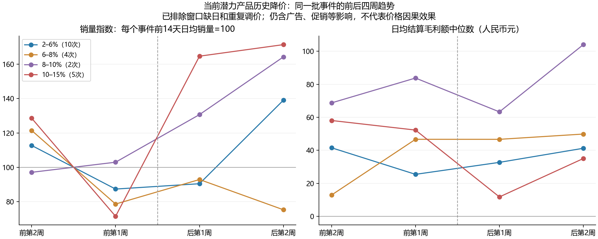

# 潜力产品历史调价与幅度分析

> 查询日期：2026-09-23。只读历史分析；不生成产品执行清单、不配置规则、不下发动作。

## 1. 先给结论

**不应继续把2%写成所有潜力产品的统一调价幅度。但现有数据也不能证明统一改为5%或8%会更好。**

- **降价：建议把下一轮业务试探的名义步长放到5%，作为待验证候选，上限5%，继续受P25截断。**历史约5%的降价有可参考的销量、利润改善案例；6%以上并没有更一致的收益证据。这里的5%是依据探索结果选择的试探方案，**不是已验证安全幅度或最优幅度**。
- **提价：单独校准，不能把降价结果反用为提价依据。**本次没有足够“低于P25、近期日销>3、广告稳定”的可比提价事件，无法从历史数据给出统一3%、5%或8%的可靠推荐；原2%同样没有被验证。
- **仍然先处理广告，仅明显异常价格才调。**本次能核实调价前标签、窗口完整且基线日销≥1的降价事件中，**0次同时通过当时现价≥1.10×P35、降后≥P25这两项价格条件**。因此，本次不能声称已经验证了新版全部策略；10%异常线和14天间隔也未被证明最优。

## 2. 样本、数据与比较方法

### 2.1 两组对象分开看

| 对象 | 定义 | 可用性与局限 |
|---|---|---|
| 主样本 | 2026-09-22七国正常在售301/current与潜力1302/30d交集，共178个国家＋店铺＋MSKU | 找到248次价格确实变化的成功记录。只说明当前潜力产品的历史表现，存在按现状选样的偏差，不能当成历史潜力完整群体。 |
| 当时潜力补充样本 | 近30天曾为1302的465个对象，事件前一天有1302/30d标签 | 匹配13次真实调价；历史标签仅2026-08-24至09-22，较早事件不能补造标签。未将“当时正常在售”认定为全部已验证。 |

近30天潜力对象共关联739条成功调价记录，剔除5条价格未变，734次中包含上述248次及13次，**两组可能重叠，不能相加**。调价源表覆盖2026-04-23至09-21；经营数据查询2026-04-01至09-22，效果窗口截止09-20，留出最近两天，仍不保证结算后续不会回补。

### 2.2 实际采用的来源

| 内容 | 来源与口径 |
|---|---|
| 成功调价事件 | `ods_datasync.lx_sale_adjust_price_queue`，`processing_status=3`、`delete_flag=0`，前后JSON的`standard_price`，同币种、正数、确实变化；同对象＋完成时间＋原价＋新价去重。按国家＋店铺前缀＋MSKU联接。 |
| 历史角色 | `dws_datasync.dws_标签表汇总`，事件前一天1302/30d；只用当时已有标签。 |
| 每日经营事实 | `dwd_datasync.lx_statistics_product_performance`按店铺＋MSKU＋国家＋起止日取最新同步记录，以`relate_id`连到ODS同名表的主键。销量volume、销售额amount、结算毛利gross_profit、广告花费spend等均取ODS。 |
| 归属检查 | ODS `price_list`中所有条目的国家＋完整店铺名＋MSKU必须唯一且与目标一致；7811个待用日记录无法通过此检查而排除，最终12989个有效日记录，无重复对象日。不能把多对象汇总利润归给单个MSKU。 |
| 价格与库存辅助检查 | ODS `price_list.price/source_rate`还原原币报价用于一致性筛查；实际幅度始终来自成功调价记录。库存取FBA可售＋FBM可售。 |
| 历史P25/P35 | `temporary_dwd.在库节点_输出定价表_每日快照`，只取事件前一天；保留2026-08-24至09-23，不用现在的模型价格倒填过去。 |

**已发现并处理的数据冲突：**最初用`temporary_dwd.产品表现`探索，抽取623个比较期对象日，与ODS核对销量、销售额、毛利、广告花费，360个对象日至少一项不一致；其中销量差异只有3日，大量差异出现在金额字段。后续已弃用该表的效果结论，重读ODS并重新计算；下文全部为重算结果。差异原因尚未查明，不能擅自归为回补或汇率。本报告不采用初步日表结果。

### 2.3 怎么比较

- D为成功完成日，排除D当天；比较D−7至D−1与D＋1至D＋7，另算前后14天。每一天必须有唯一有效记录，缺日不补零；前后窗口内有其他成功调价则剔除。
- 基线日销至少1：7天销量≥7、14天销量≥14。按事件计算销量变化比例，再取中位数；毛利额用“调后日均−调前日均”，不把亏损转盈利硬算成利润增长率。毛利率为窗口毛利合计÷销售额合计。
- **进一步筛查干扰**：每一天FBA＋FBM可售>0；广告花费变化绝对值≤20%（两期均0可通过，单边0不通过）；促销折扣占销售额变化≤1个百分点、促销销量占比变化≤10个百分点；两期各自报价波动≤2%，前后报价比例与调价记录差异≤2%。这些是本次分析筛选条件，不是新运营动作门槛。
- 2%–6%组用于容纳约5%的常见金额取整；例如实际5.004%不应机械当作“另一档”。分组为左开右闭，剔除0变动；不把6%当作推荐上限。
- 各组不是随机分配，没有未经调价的同期对照，也未完全控制竞品、费用调整、退货、季节性、广告投放结构。广告花费稳定不等于广告设置未变。**只报告趋势关联，不报告因果收益或安全概率。**

| 主样本过滤结果 | 7天比较 | 14天比较 |
|---|---:|---:|
| 窗口完整且无重复调价 | 97 | 68 |
| 再要求基线日销≥1 | 40 | 34 |
| 再通过库存、广告、促销及价格筛查 | 19 | 14 |

7天与14天事件集合不同，不能把两张分组表直接连起来当同一批产品的趋势。

## 3. 降价：约5%有探索价值，大幅降价没有更一致的收益

### 3.1 当前潜力产品：调价前后7天

下表已要求窗口完整、无重复调价、基线日销≥1，尚未排除全部可见干扰。

| 实际调价幅度 | 事件数 | 日销变化中位数 | 日均结算毛利额变化中位数（元） | 毛利额未下降 |
|---|---:|---:|---:|---:|
| 0–2% | 1 | -69.0% | +53.6 | 1/1 |
| 2–6% | 13 | +28.6% | +11.5 | 10/13 |
| 6–8% | 4 | +6.0% | -22.9 | 1/4 |
| 8–10% | 2 | +26.6% | -20.5 | 0/2 |
| 10–15% | 4 | +31.0% | -37.9 | 0/4 |
| >15% | 5 | +9.1% | +5.5 | 3/5 |

进一步筛查后：

| 实际调价幅度 | 事件数 | 日销变化中位数 | 日均结算毛利额变化中位数（元） | 毛利额未下降 |
|---|---:|---:|---:|---:|
| 0–2% | 1 | -69.0% | +53.6 | 1/1 |
| 2–6% | 7 | +40.0% | +14.0 | 6/7 |
| 6–8% | 2 | -17.5% | -25.8 | 1/2 |
| 10–15% | 1 | +328.6% | -38.5 | 0/1 |
| >15% | 1 | +130.0% | -12.8 | 0/1 |

约5%组从13次缩到7次，后者日销变化中位数+40.0%，日均毛利额变化中位数+13.96元，6/7次毛利额未下降。**这支持优先测试约5%，不等于5%一定有效。**0–2%组只有1次，没有条件验证“2%太小导致没效果”；6–8%、8–10%与10–15%的样本也少，不能做可靠排名。

这7次来自德国1次、法国2次、荷兰1次、西班牙3次；没有美国、英国、意大利样本，不足以验证七国通用的收益幅度。

### 3.2 当前潜力产品：调价前后14天

| 实际调价幅度 | 事件数 | 日销变化中位数 | 日均结算毛利额变化中位数（元） | 毛利额未下降 |
|---|---:|---:|---:|---:|
| 0–2% | 1 | -40.9% | +28.0 | 1/1 |
| 2–6% | 10 | +14.6% | +2.9 | 5/10 |
| 6–8% | 4 | -11.2% | -7.4 | 1/4 |
| 8–10% | 2 | +47.5% | +7.4 | 2/2 |
| 10–15% | 5 | +16.7% | -23.8 | 0/5 |
| >15% | 3 | +44.4% | +0.4 | 2/3 |

进一步筛查后：

| 实际调价幅度 | 事件数 | 日销变化中位数 | 日均结算毛利额变化中位数（元） | 毛利额未下降 |
|---|---:|---:|---:|---:|
| 0–2% | 1 | -40.9% | +28.0 | 1/1 |
| 2–6% | 4 | +19.3% | +5.0 | 2/4 |
| 6–8% | 1 | +13.3% | -13.1 | 0/1 |
| 10–15% | 1 | -3.1% | -33.2 | 0/1 |
| >15% | 1 | +172.0% | -17.1 | 0/1 |

约5%组严格筛查仅4次，销量变化中位数+19.3%，毛利额仅2/4次未下降。**7天表现较好，不意味着14天持续盈利。**因此5%候选仍需同时观察第2周，不适合按周连续追加降价。

### 3.3 同一批事件的四周趋势

下面每条线固定为通过14天完整窗口、无重复调价、基线日销≥1的同一批事件。未额外排除广告、促销等干扰，仅用于检查前趋势与效果是否延续。销量先按各事件调前14天日均=100归一，再逐周取中位数；两张图统计量不同，不可彼此直接相除。

约5%组的销量指数依次为112.7、87.3、90.4、139.1。调价前已经从前第2周下滑到前第1周；调后反弹可能包含自然波动恢复，不能全部归功于降价。10%–15%组的销量上升更明显，但调后两周的日均毛利额中位数仍低于调前，进一步说明“销量涨得更多”不等于“应该降得更多”。

## 4. 调价当时就是潜力的样本：证据更弱

13次有事件前一天潜力标签的调价，7天比较通过完整窗口、无重复调价及日销≥1的有5次，进一步筛查剩4次；14天进一步筛查仅1次。

当时潜力且进一步筛查后的降价：

| 实际调价幅度 | 事件数 | 日销变化中位数 | 日均结算毛利额变化中位数（元） | 毛利额未下降 |
|---|---:|---:|---:|---:|
| 2–6% | 3 | -23.1% | +20.7 | 2/3 |

约5%的3次降价，日销变化中位数**−23.1%**，毛利额2/3次未下降。这与“当前潜力回看历史”的较好结果并不一致，说明选样方式会改变结论。

更关键的是，3次具备7天基线条件的当时潜力降价中，**0次同时满足事件前现价≥1.10×P35及降后≥P25**。部分历史动作低于P25或利润本已不足；其结果不能作为新版价格条件的合格回测。

## 5. 提价：不能跟降价用同一结论

当前潜力产品、基线日销≥1的7天提价表现：

| 实际调价幅度 | 事件数 | 日销变化中位数 | 日均结算毛利额变化中位数（元） | 毛利额未下降 |
|---|---:|---:|---:|---:|
| 2–6% | 1 | -56.2% | +56.5 | 1/1 |
| 6–8% | 1 | -31.6% | +19.7 | 1/1 |
| 8–10% | 2 | -30.5% | -32.1 | 0/2 |
| 10–15% | 4 | +7.7% | +0.5 | 2/4 |
| >15% | 3 | -6.7% | +13.7 | 2/3 |

2%–6%组仅1次，销量减少约56.3%，同时广告花费减少约92%，无法拆分价格与广告作用；严格筛查后该档没有样本。8%–10%组2次毛利额均下降。更大幅度也没有足够可比证据。

提价业务要求比上述表更严：低于P25、30天及7/14天销量维持>3、广告已处理、无促销结束干扰。因此**本次无法给出该提价路径统一应涨多少的历史结论**。不把降价5%的候选迁移到提价，也不宣称原2%已验证。

补查有事件前P25且前7天日销>3、旧价≤P25的90%的提价，完整7天窗口仅2次：一次实际提价约8%，后7天日销下降约71%，同时广告花费变动约92%，当时未核实潜力标签；另一次提价约11.34%，后7天日销下降约77%，同期有缺货及广告变化。前者虽通过14天干扰筛查，第2周合并的14天日销仍较调前下降约67%、日均结算毛利额下降约13.7元，也只能作为风险案例，不能外推到5%。**这两次均不是“当前路径下提价5%”的合格效果样本。**

## 6. 如何落回动作建议

| 动作 | 本轮建议 | 数值的证据等级 |
|---|---|---|
| 降价首轮 | 满足原路径、广告先处理且价格明显偏高时，**试探5%**；`目标价=max(现价×0.95,P25)`，按货币最小单位向上取整，实际降幅≤5%。若碰到P25，实际幅度可以小于5%。 | 探索后选择的业务候选，未完成适用路径回测。 |
| 降价后续 | D+7看日销、订单毛利率及结算毛利额；D+14确认第2周是否持续。销量增加但毛利额下降，也不能算成功。原14天间隔继续作为试探限制，不宣称已校准最优。 | 保留现有复盘框架；本次14天结果提示不能只看第1周。 |
| 一次降6%–8%或更高 | 不升为通用动作。需要该对象自己的合格历史，或另设有业务批准的小样本测试。 | 当前分组稀疏，且利润表现不一致。 |
| 提价首轮（2026-09-24策略补充） | 明显低于P25、日销稳定>3，广告与其他干扰核清后，**试探最多5%**；`目标价=min(现价×1.05,P25)`，按币种精度向下取整。执行后按D+7和D+14的日销、订单毛利率、可比日均毛利额决定维持或回调。 | 5%是为小范围试探设的上限，**没有合格历史样本证明安全或最优**；不能把降价5%的结果反用。 |

这次可以落定的是：**取消统一2%的说法，降价与提价分别设置最多5%的受控首轮试探，均以异常价、广告优先和执行后复盘为前提。**提价5%属于2026-09-24补充的策略选择，历史证据缺口仍在；不能落定“潜力统一适合5%–8%”“5%为最佳”或“高于P35达10%才有收益”。

## 7. 敏感性与复算说明

广告花费稳定阈值从20%改为10%／30%时，约5%降价样本如下。仍使用同样的库存、促销、价格、日销检查；分母小，结果波动不能当成精确收益预测。

| 广告花费变动上限 | 比较窗口 | 事件数 | 日销变化中位数 | 日均毛利额变化中位数（元） |
|---|---|---:|---:|---:|
| ±10% | 前后7天 | 4 | +40.6% | +18.7 |
| ±10% | 前后14天 | 3 | +23.8% | -4.6 |
| ±20% | 前后7天 | 7 | +40.0% | +14.0 |
| ±20% | 前后14天 | 4 | +19.3% | +5.0 |
| ±30% | 前后7天 | 11 | +28.6% | +12.2 |
| ±30% | 前后14天 | 6 | +19.3% | +2.9 |

复算时固定上述标签日期、国家、完成时间和窗口。查询顺序为：标签确定对象 → 成功队列确定事件 → DWD定位每天最新同步的ODS主键 → ODS核实唯一归属 → 排除重复调价及缺日 → 分别计算每个事件的前后7/14天 → 按方向和幅度汇总。金额不跨原币相加，原币只计算各事件调价比例；经营金额统一使用ODS的人民币口径。

本轮分析脚本和中间数据仅在本机临时分析目录，未接入业务程序。交付内容为本报告、汇总趋势图及策略文档的修订；不交付真实产品执行名单。
