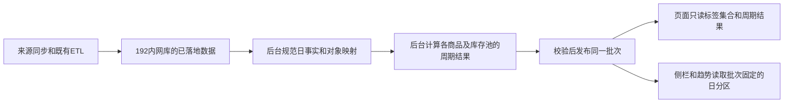

# 内网分析结果表与预计算设计

状态：首批结果已发布，8001已切换到内网预计算链路，真实数据接口及无界面浏览器验收通过。以下“表分层”保留最终设计，具体已启用范围以文末实施记录为准。

## 存储位置与现状

用户已确认沿用项目配置中的内网看板MySQL：`192.168.112.235:3306 / etl_datasync_test`。这里的“本地结果库”指这台内网服务器，不是运行浏览器的电脑。迁移工具核验目标地址及库名，不记录账号、密码。

迁移前结果准备绑定页面请求：`AnalysisRepository.load()`加载经营日事实、库存日历、补货结果，并通过`ProductTrafficRepository`和`SellableCostRepository`额外读取业务来源，再由`prepare_rows()`逐商品逐日计算、`aggregate()`汇总。原pickle缓存只能加快重复请求，代码或来源版本变化、未准备的新周期仍触发这条链路。当前默认Web读取器已替换，旧读取器只用于离线准备和受控验收。

实测一次180天接口等待551.123秒，含共享服务重启、并发查询与等待同周期准备的影响，不能作为独立SQL基准。这足以说明页面请求不应该承担完整数据准备。

项目已有可复用的落地数据：

| 现有表/模块 | 使用方式 |
| --- | --- |
| `dashboard_product_performance_daily` | 已发布经营、利润、广告、退货日事实；在后台按分析对象归一，不在页面重复归并local_sku |
| `dashboard_label_source_performance` | 已同步的产品表现原始来源，优先在此准备总会话、PV、订单量和销量CVR；先验证字段与历史覆盖 |
| `dashboard_inventory_daily_snapshot` | 库存日快照；缺行、空值处理及共享关系仍需核验 |
| `dashboard_label_source_fba`、`dashboard_label_source_raw_fba` | 已落地FBA来源，核验可售数量和可售库存成本字段；不足部分由独立后台同步补齐 |
| `dashboard_pur_plan_replenish_data` | 日销、支持天数等已发布补货结果，复用当前计算链路 |
| `dashboard_label_fact_snapshot`及`dashboard_label_local_history` | 标签事实与历史；保留标签原口径，不由分析任务重打标签 |
| `dashboard_label_local_source_batch` | 已有输入批次、内容校验和与来源合同，复用来源证据；原始落地表不能假设天然保留所有历史批次 |

## 表分层

采用“日事实＋商品周期结果＋标签关联＋常用汇总”。金额、流量、库存池和补货需求对象有不同粒度，不合并成一张混合粒度宽表。主数据与批次表是支撑表，不承担业务计算。

| 新表（前缀`dashboard_analysis_`） | 一行代表什么 | 保存什么 |
| --- | --- | --- |
| `object` | 一个分析商品对象 | 视角、国家类别、国家、店铺、MSKU、稳定object_key；两种视角分别建对象 |
| `business_daily` | 一个来源分区中的商品一天 | 经营、利润、广告、退货原子值及字段有效性 |
| `traffic_daily` | 一个来源分区中的商品一天 | 产品表现的会话、PV、订单量、销量及浏览器/移动端细分，不保存广告点击冒充总流量 |
| `inventory_daily` | 一个来源分区中的库存池一天 | 可售数量、总库存成本、可售库存成本、库存状态、异常说明 |
| `inventory_map_daily` | 一个来源分区中的商品一天 | 当天库存池、补货需求对象、映射证据、明细继承日销；不能用今天的映射回填历史 |
| `supply_daily` | 一个来源分区中的补货需求对象一天 | 有效日销、完整需求库存、FBA覆盖天数、支持天数、到货支持及缺口结果 |
| `object_tag` | 一个发布批次/截止日下的一个商品命中一个标签 | 父/子标签、标签周期、实际标签日期、原命中证据引用 |
| `business_period` | 一个批次下的商品×截止日×周期 | 销量、金额、毛利、广告、退货等周期合计和共同有效样本信息 |
| `traffic_period` | 一个批次下的商品×截止日×周期 | 流量原子合计、两种CVR各自的共同有效分子/分母、记录覆盖 |
| `stockout_period` | 一个批次下的商品×截止日×周期 | 断货天数、有货/未知/有效天数、当前状态、连续天数、事件次数和边界标记 |
| `inventory_period` | 一个批次下的库存池×截止日×周期 | 数量/成本日和、有效天数、完整性；库存均值与周转依赖保持独立 |
| `tag_summary` | 一个批次下的常用范围×单标签×截止日×周期 | 常用入口的汇总结果和分母，仅作可重建的加速表 |
| `source_partition`、`batch_partition` | 一个域一天的不可变来源版本、发布批次引用的分区 | 区分真实无记录、尚未同步、来源失败、超出来源范围，固定侧栏与趋势读取版本 |
| `batch`、`publication` | 一次计算批次、当前发布指针 | 公式版本、输入校验和、实际来源日期、可用截止日/周期、质量报告及发布状态 |

对应建表脚本：[`label_analysis_read_model.sql`](../../sqlcode/label_analysis_read_model.sql)，已由目标校验后的后台迁移执行。SQL仅定义独立新表；同步、计算和发布由预计算任务完成，不删除旧表。

## 断货周期结果的具体字段

`stockout_period`提前保存：`stockout_days`、`instock_days`、`unknown_days`、`valid_days`、`expected_days`、`current_stock_state`、`current_stockout_days`、`max_stockout_days`、`confirmed_events`、`current_lower_bound`、`max_lower_bound`。

它保留单商品原子结果，页面不再读取180天库存明细并重新跑日历：

| 页面指标 | 本地结果上的轻量汇总 |
| --- | --- |
| 周期断货商品数 | 有`stockout_days>0`的商品数 |
| 累计断货天数 | `stockout_days`合计 |
| 当前断货商品数 | `current_stock_state=0`的商品数 |
| 当前断货率 | 当前断货商品数÷截止日状态为有货/断货的商品数 |
| 周期断货发生率 | 周期断货商品数÷`valid_days>0`商品数 |
| 缺货天数率 | 断货天数合计÷有效库存天数合计 |
| 断货商品平均断货天数 | 断货天数合计÷周期断货商品数 |
| 连续断货≥7天商品数 | `current_stockout_days>=7`商品数 |
| 当前已恢复有货商品数 | 曾断货、截止日状态为有货的商品数 |
| 周期最长连续断货天数 | 单商品`max_stockout_days`的最大值 |
| 库存记录完整率 | 有效天数合计÷应统计天数合计 |

0库存确认断货，正库存确认有货，缺行、负库存、冲突映射保持未知；整期持续零库存仍纳入。无有效库存观察的商品，其断货天数保持空值；分母为0的比率不产生假数值。当前连续天数与周期最长连续天数的边界分别保存。第一批迁移沿用现有窗口裁剪和下限规则，不能悄悄改成另一种全历史连续天数。

库存池天数另由`inventory_daily/period`去重计算，不能把商品天数称为库存池天数。

## 标签组合与金额去重

先从对象范围和`object_tag`取得商品ID集合：同类标签并集、跨类交集；采用`exists`或去重ID集合，避免直接连接标签表把一件商品放大成多行。总体、上层、当前三套集合复用同一批次和条件顺序。

随后分别聚合商品周期结果、截止日去重库存池、截止日完整补货需求对象。库存成本按所选商品关联的库存池去重；覆盖天数使用完整需求对象结果，不按选中国家或某个标签缩减需求。群体毛利率、CVR、CTR、ACOS等采用共同有效分子合计÷分母合计。

**不预计算所有任意标签组合。** 任意组合数量会迅速增长，且重叠标签汇总不能直接相加。按商品预计算后，动态联动只需筛选数千/数万条周期结果并轻量聚合。`tag_summary`只提前计算“全范围”“可售天数>180天”等明确常用范围；其他组合从原子结果聚合。

上期使用当前选中的商品ID，读取它们的上期周期结果，不改为上期标签成员。前期未出现商品在经营来源完整时按无记录0处理，库存无观察保持未知。

## 准备任务与发布

新增独立后台准备任务，例如`etl.label_analysis_refresh`，位于经营、库存、标签和补货的已有准备任务之后。复用已同步原始表，不在新的分析任务里重复整表拉取远端；来源不足由明确的同步步骤补齐。

- 默认准备7、14、30、60、90、180天，以及它们所需的上期截止日；60/180天分析使用已发布30天标签，原周期维持原标签窗口。
- 首次按明确的历史范围分段回填。每天处理新增日期和发生回补的日期；流量回补窗口按来源更新方式配置，不能机械只同步昨天，也不能每次全历史重拉。
- 标签、库存、流量、补货的来源日期分别保存。截止日只允许已完成准备的日期；日期不齐不伪装成同日。
- 日事实按域/日期分区版本追加；新批次引用没有变化的旧分区，仅重建变动日期，避免每天复制全年数据。旧批次引用的分区不可覆盖。
- 标签字典和命中证据也固定到分析批次；`object_tag.evidence_json`保留当时的证据，不能仅存一个指向会被覆盖的旧表的引用。补货结果完整保留在`published_result_json`，供侧栏说明和尚未独立规范的字段使用，不能把不同粒度的库存数直接相加。
- 一个批次的结果全部写入`building`状态，验证后成为`ready`；短事务中切换`publication`指针。读端保留旧已发布批次，更新失败仍提供上一次完整数据。
- 历史回补应重算与该日期有交集的已支持窗口，以及被影响的截止日库存/需求映射；不只更新日事实而留下旧周期结果。
- 旧批次和无引用分区的清理在独立维护任务中执行，保留期限覆盖URL/下载使用的版本有效期。本方案不含自动删除操作。

## API边界和迁移顺序

页面接口`meta/summary/details/trends/export`仅使用`DashboardDbService.connect()`访问192结果库，禁止调用`source_connect()`、标签生成、补货计算和准备任务。页面刷新只读取最新发布版本；未准备的周期明确提示未准备，绝不悄悄回退到远端现场计算。

1. 核验现有内网产品表现/FBA落地表的字段、每日数据覆盖、NULL与0及源批次；补齐流量和可售库存成本日事实。
2. 建立对象、映射、标签关联和发布元数据，先完成断货周期结果、经营周期结果以及截止日库存/补货结果。
3. 完成流量周期结果、趋势/侧栏日分区和常用标签汇总。后台按目标日期回填并对账。
4. 保留旧读链路作为受控验收工具，对同一批次、日期、视角、任意标签组合核对商品数、销量、金额、流量、断货、比例、分布和CSV。
5. 通过后整体切换新页面所有接口；移除Web请求上的远端读表和逐日准备。旧页面仍使用原接口，不扩大迁移范围。

迁移实现时新增后台测试：在Web测试中把`source_connect()`替换为立即报错的函数，五个接口仍应完成；同时验证查询不调用准备器、所有模块返回同一批次，以及更新过程中旧批次仍可读取。

性能验收目标是待实测的设计目标：预计算后常用汇总尽量控制在1秒左右，分页明细在数百毫秒到1秒；分别测冷进程、本地结果首次读和重复读，记录数据量及P50/P95，不用热缓存单次成绩代替真实查询性能。

## 本次已有交付

### 2026-10-14 预计算切换实现

本次先启用商品主数据、经营/流量/断货周期结果、库存商品结果、周期上下文、标签关联、常用标签汇总、批次与发布指针。四个指标域分别保存，不把标签关联或共享库存直接连接放大金额。`object_history` 保存带校验和的压缩日历与命中证据，侧栏和趋势从当前批次归档读取。归档保留最长周期数据及全部六个上期截止日的补货映射。

建表脚本共20表，包含分块进度表 `dashboard_analysis_scope`；另有离线流量输入、成本输入和输入状态3表，共23表。设计中的规范日事实、日映射、供需日结果、库存池周期及来源分区引用共8表只建立结构，尚未回填。当前趋势采用批次不可变归档；这已解除HTTP中的日历准备，独立日分区复用仍为后续优化，不应宣称已全部实施。

实查现有内网标签来源镜像未包含完整产品表现流量字段，也没有可靠可售库存成本字段。独立任务按7天分段同步产品表现最长360天窗口并在内网保存输入；可售成本读取当前及六个上期日期，保留与库存快照的对齐检查。主进程只同步和记录版本，不持有整窗数据。远端读取只发生在离线任务。来源版本相同时复用输入；版本改变或无法判断历史是否回补时整窗重载，避免30天外回补遗漏。缺日增量范围覆盖此前最后加载日之后的所有日期。

准备器按国家类别、店铺和最多80个规范化MSKU分块，SQL过滤下推到内网源镜像和输入表。默认2个后台进程，可用 `--workers 1..8` 调整；本次首次准备使用8个低优先级隐藏进程。每个进程默认512MB预算，父进程监控实际占用；每块的12个视角／周期结果及历史归档一起提交。全群体汇总由单独的后台进程计算，预算1024MB，先去重库存池和需求对象再求中位数及贡献。分块不能自行求中位数后相加。

`--resume <batch_id>` 只复用相同代码、公式、来源版本、输入代次、截止日和商品范围的已完成分块。MySQL JSON键顺序不参与版本判断。遇到数据库死锁／锁超时，完整回滚该块后最多重试4次；对象维度注册使用单独短事务，不把重复键锁保持到全部周期写完。发布前再次核验代码和来源，并核对所有域的行数，旧发布指针在失败时保留。

当前按周期读取的经营、库存和流量历史仍有重复。后续可建立每块只读底座，再按周期投影，但必须保留各周期商品名单、标签窗口、国家集合和未映射商品去重规则；不能直接把180天结果裁剪为7天结果。该优化尚未实施。

手动执行 `python -m etl.label_analysis_refresh`，默认取192库 `dashboard_label_fact_snapshot` 最新日期，准备7/14/30/60/90/180天及国家类别/国家两个视角。发布要求所有12个窗口完整、分域行数一致、序列化指标对账通过、标签日期及来源版本没有变化。失败不切换指针；原标签事实不生成、不修改，旧分析批次保留。

任务已接入 `etl.daily_update_runner` 和 `scripts/run_daily_update_task.ps1` 的输入任务之后；不新增定时任务。本次只运行分析准备及验收，未触发整套日更或钉钉通知。原有返厂策略步骤对 `--biz-date` 的兼容问题不在本次改动范围内，带该参数执行完整PowerShell链路仍需核查；标签步骤仅转发dry-run，截止日始终取已发布标签最新日。

Web默认使用 `MaterializedAnalysisRepository`，不再调用来源连接、逐日准备或旧pickle自动回退。刷新重读已发布批次，跨日发布自动恢复可用日期；URL固定批次在进程重启后仍有效。字段、公式、0/缺失处理、全部运营状态和标签组合规则沿用原实现。

此前页面调整（迁移前记录）：缺货列组改为商品数、断货天数和各类比率，补充恢复有货、连续断货及最长天数，支持60/180天。该轮61项测试及8001无界面验收通过，当时尚未切换预计算存储。

### 首批发布与真实验收

2026-10-14 07:59完成首批发布，批次 `1cbebf76-d78c-41f5-9ca3-aad5f5644dfe`，截止日为标签镜像最新的2026-10-12，包含全部12个窗口。171块计算及全群体汇总共1879.96秒，约31.33分钟；分块进程最高425.1MB，全群体汇总进程最高830.4MB，分别在512／1024MB预算内。之前持有整窗历史的大进程已停止，不再使用。

每个周期域共有598490条当前／上期结果，5域行数一致。180天对象数为类别视角8963、国家视角42116，与原读取链路同截止日一致。实际来源2天流量18749个国家商品身份逐字段一致；禁止`source_connect()`和`prepare_rows()`后，真实30／180天汇总、明细、商品侧栏、趋势、导出及重启后版本恢复全部完成。储存汇总与商品聚合一致，当前和上期库存趋势截止点与汇总一致。日志为 `.codex_tmp/label_analysis/cutover-live-data.log`。

另外修复了读模型连接顺序：原执行计划从经营域开始，预计扫描约247969行并使用临时表／文件排序；当前`select straight_join`从商品上下文的日期／周期／视角／阶段主键范围开始，其余4域按完整主键逐条关联。实查执行计划不再出现临时表和文件排序，不修改任何指标公式或持久化数值。

8001新进程中对“FBA可售天数>180”的385个对象实测：30天汇总首次3.3108秒、3次重复0.1157／0.1198／0.1888秒，20条明细0.0195秒；180天首次3.4526秒、重复0.1066／0.1047／0.1050秒，明细0.0181秒。首次指进程尚未加载该窗口，内网数据库可能已有缓存；这些数值只代表本次范围，不替代全范围、国家视角或P95。首次查询尚未达到1秒设计目标，常用范围重复查询已达到。证据为 `cutover-performance.json`，不能把此前551秒直接作为纯SQL对比基准。

最新后台自动化测试125项通过，1.41秒；服务以隐藏进程运行在8001，`MainWindowHandle=0`。

无界面浏览器核验旧失效URL恢复、固定批次URL重载、刷新、标签表、抽屉、断货下钻、CSV及390px窄屏通过，脚本错误0，核心385个对象的数量、经营金额、库存金额及断货指标与迁移前参考一致。30天内47个曾断货、累计1038天、当前29个断货。国家视角另核验Jijutian店铺488个对象、5页全部排序、完整CSV身份与顺序、同大类OR／跨大类AND及固定当前成员的当前／上期趋势，通过。日志为 `cutover-browser.log`、`cutover-stockout-browser.log`、`cutover-country-http.log`；桌面与窄屏截图已人工读取检查。

验收后恢复默认30天全范围8472个对象，首次汇总6.113秒、重复0.122秒、20条分页0.024秒。首次包含从国家视角切回后的窗口载入及全范围汇总；页面所需的默认窗口已读取，后续相同条件直接复用。此成绩与前述385对象专项范围分开报告，证据为 `warm-default.log`。
