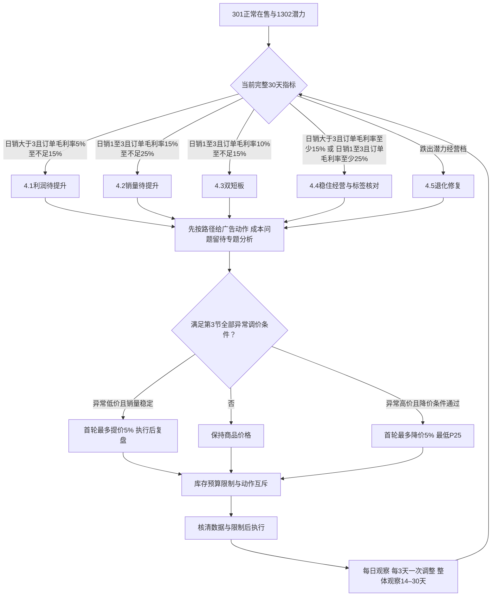

# 七国潜力产品运营动作建议

> 2026-09-30修订：取消价格动作、广告总动作、正向加投及首批提价候选的数量上限，同时取消库存分档中的动作数量限制。各对象独立满足条件即可同轮处理；保留路径、幅度、TACOS、预算、库存天数、先广告后价格、互斥、复盘及防重复约束。数量不限不表示可连续重复调价或叠加幅度；同一价格仍需形成唯一有效目标。本次仅更新文档及待建档规则，不代表已写库或上线。

## 毛利口径统一（2026-09-30确认）

问题产品、瘦狗产品和潜力产品的经营分流、调价、广告准入、路径切换及效果复盘统一使用**订单毛利率**。本文未单独限定的“毛利”“实际毛利”“margin”均指订单毛利率，不使用结算毛利率替代。

- 数据来自同一层、同一版本的产品表现日表；当前 DWD 为 `dwd_datasync.lx_statistics_product_performance`，订单毛利润字段为 `predict_gross_profit`，销售额字段为 `amount`。需要 ODS 复核时通过 `dwd.relate_id = ods.id` 对齐，不混拼两层金额。
- 经营分流使用最近完整 30 天：`订单毛利率 = sum(predict_gross_profit) / sum(amount)`；按国家＋店铺＋MSKU、同一窗口、同一币种汇总。日销为同窗口 `sum(volume) / 30`。
- 保留零销量日的订单毛利润及负值；不平均每日 `predict_gross_margin`，不再减一次广告费；`sum(amount) <= 0` 或必要数据缺失时输出待核，不当作零毛利率。
- 3/7/14 天等复盘保留原有窗口长度，但每个窗口均使用上述订单毛利率公式。阈值 5%/10% 等在计算中使用 0.05/0.10；标签 JSON 的百分数值须除以 100。
- `gross_profit`、`gross_margin` 属于结算口径，不参与本策略毛利判断；成本快照只用于成本项诊断，不能替代订单毛利率来源。P5/P10/P15/P20/P25/P30 等仍是定价模型价格线，不等于实际订单毛利率或调价后保证达到的毛利率。
- 本次统一毛利指标，不改变已确认的价格档位、调价幅度、库存、预算和历史动作约束；文档更新不代表生产计算已同步。

> 业务审核稿｜2026-09-23  
> 按“选路径 → 优先优化广告 → 仅对明显偏离模型价的产品小步调价 → 检查库存预算 → 复盘”执行。仅交付动作建议，不配置规则、不执行价格或广告操作。

## 1. 对象、目标与参数依据

### 1.1 哪些产品进入

七国 DE、FR、IT、ES、NL、UK、US，满足正常在售 `301/current` 与站点潜力 `1302/30d`。301 按店铺＋MSKU 联接；后续判断始终按**国家＋店铺＋MSKU**。

数据库 `dws_标签详情表` 当前启用的站点口径如下，不能套店铺级日销 5 的门槛：

| 站点角色 | 数据库文字条件 |
|---|---|
| 潜力 1302 | 日销 `>3`、打标毛利 `5%–15%`、有效小类排名 `≤100`；或日销 `1–3`、打标毛利 `10%–25%`、排名 `≤100`；或销量／毛利达到明星组合但排名 `51–100`。 |
| 明星 1301 | 日销 `>3` 且打标毛利 `>15%`，或日销 `1–3` 且打标毛利 `>25%`；同时有效小类排名 `≤50`。 |

数据库文字说明使用明星毛利严格大于，仓库打标 SQL／诊断使用大于等于。**本稿用 15%／25% 作为经营目标；恰好等于门槛时，以当期标签与证据复核晋级，不擅自修改标签。**分流条件和动作判断统一使用订单毛利率，不使用结算毛利额作动作门槛。

### 1.2 双层目标

| 目标 | 达到什么条件 | 后续怎么做 |
|---|---|---|
| 经营达到明星销量／利润组合 | 完整 30 天日销 `>3` 且订单毛利率 `≥15%`；或 `1≤日销≤3` 且订单毛利率 `≥25%` | 停止主动降价和继续拉量；保留广告止损、利润修复与标签核对。 |
| 标签升级为明星 | 最新可比标签为 `1301/30d` | 退出潜力动作池。 |
| 仅排名未达 | 已达上述经营组合，排名仍为 `51–100` | 维持价格及有效广告；排名差不触发涨 bid。 |
| 退化 | 最新经营指标低于潜力对应销量／毛利档，或日销为 0 | 停止潜力正向动作，按第 4.5 节分流。 |

### 1.3 哪些数字来自哪里

- **用户确定的潜力底线：P25。**所有新降价目标不得低于 P25；存量价低于 P25 的产品可以分步修复。
- **模型价格只用于比较偏离程度，不再作为逐档调价目标。**P25 是新降价底线及存量低价的比较基准，P35 是高价比较基准；不再执行 P35→P30→P25 或低价逐档上调。
- **价格首轮调整：明显高价最多降5%；日销>3、订单毛利率5%至不足15%、明显低于P25且销量稳定时最多提5%，都在执行后复盘。**降价约5%的历史样本有一定参考价值；提价5%缺少符合当前路径的可比样本，作为首轮上限，D+3判断维持、恢复或下一轮，整体观察期14–30天。提价与降价各按第3节的触发条件执行，不把降价结果当提价证据。详见[历史调价与幅度分析](../2026-09-23-潜力产品历史调价与幅度分析.md)。
- **价格限制：偏离10%才启动调价，两次正常调价至少间隔3天。**偏高指 `现价≥1.10×P35`，偏低指 `现价≤0.90×P25`。10%与3天是本稿采用的动作参数，执行后按复盘结果调整。
- **2026-09-29零单点击档修订：**手动关键词成熟30天零单，点击不足10保持，点击≥10且归因、保护和对象条件通过时**bid降8%**；自动匹配方式零单，**点击<30保持，点击≥30且有效正花费、归因、保护和对象条件通过时bid降8%**。不因更多点击加重降幅。自动零单30点击为本版偏高的控制门槛，不声称历史已证明最优；正向档位不变。
- **零单采用“成熟零单＋点击”判断。**删除参考广告客单价及20%／50%花费比例，不借其他产品数据。此前178个产品的固定样本中，手动词≥10点击零单22个，扣除1个其他归因期有订单的对象后剩21个初筛候选；自动匹配方式在同批历史样本中满足零单、正花费、30天归因无订单且点击≥30的有2个，仍须保护、历史等前置核验，不能当作可执行清单。旧自动组样本仅作历史分析。数据来源与参数依据见[专门分析文档](../2026-09-28-潜力产品数据来源与参数分析.md)。
- **广告幅度直接写入动作卡：**正向bid `+3%/+5%/+8%`，手动词零单止损 `−8%`，有单但ACOS偏高时按4.0的 `−8%/−10%/−20%`。点击数量不直接推导降幅；−8%沿用已有小幅调整标准，执行后复盘。
- 库存限速、预算不突破、同一对象动作互斥沿用现有框架。**2026-09-29用户确定潜力TACOS以不超过5%为优先区间，10%为加投判断上限。**动作前TACOS与广告对象统一使用剔除最近7天后的完整30天：≤5%按原路径选动作，5%至10%各符合条件的有效现有对象最多升bid 5%，>10%不加投。具体见4.0；5%／10%为业务设定，不表述为历史回测最优值。

本稿直接给出动作：符合第3节完整条件时，**异常高价首轮最多降5%；异常低价且日销>3、订单毛利率5%至不足15%时首轮最多提5%**；手动词零单≥10点击、自动匹配方式零单≥30点击，达到4.0其余条件时bid降8%。价格动作后D+3比较日销和订单毛利率，符合条件可二次调整；价格和广告统一每日观察、每3天一次调整，整体观察14–30天。本稿只提出动作建议，不直接执行调价。

## 2. 同日动作包与分流顺序

不设置产品每轮价格、广告总动作及正向加投的数量上限；各对象独立满足条件即可同轮处理；**先处理广告；本轮有广告动作，售价就保持**。广告评估完整、没有本轮广告动作、待处理或待复盘事项后，才按第3节判断是否调价。成本数据尚未建设，相关问题统一注明“疑似成本异常，后续纳入成本专题分析”，本轮不生成具体成本处理动作。

- 同一产品不能同时提价、降价；同一对象不能同时涨 bid、降 bid、暂停。
- 提价前先完成适用的降bid、否词等广告动作及复盘；本轮有广告动作则保持售价。
- 降价当轮不叠加广告动作；已确认浪费先处理并复盘，广告全部核清后再判断降价。
- 同一个价格须完成D+3复盘并满3天后，才可再次调价；同一个bid须完成本轮3日复盘并重新满足动作条件，不重复调整。
- 已有广告动作仍在复盘期时，先完成至少3个完整日的复盘；结果或归因不足时继续保持价格，不把广告尚未见效直接归因于售价。价格动作自身至少间隔3天，并在每次复盘重新判断是否仍偏离10%。
- 库存、预算只决定候选动作能否通过，不单独生成“加预算、迁预算、补货”等本轮动作。

**先核日销、订单毛利率和价格数据，再优先判断退化；未退化的产品按下面顺序分流。**数据缺失只拦截依赖该数据的动作，不影响证据完整的广告止损。

## 3. 价格动作：广告优先，仅对明显偏离价格做小步调整

本节日销和订单毛利率默认采用最近完整30天数据；本轮复盘采用前后各3个完整日，整体观察期为14–30天。模型价格须同国、同店、同MSKU、同币种且顺序正常。**P25～P35以及其附近的价格，默认保持；销量或毛利不达标本身不触发调价。**

先按5.5核对广告是否启用、是否零花费，再按第4节的经营路径与对象条件选动作。广告已有动作时，至少完成3个完整日的复盘；若数据不成熟继续保持价格。若广告已核清且没有适用动作，可直接审核异常价格，不强行为了“先广告”制造一次无效调bid。广告映射不清、刚改bid或广告预算未查清，不能跳过核验直接降价。

本稿采用 **10%偏离线、每轮提价或降价不超过5%、两次调价至少间隔3天**。提价5%的效果看执行后复盘，原2%不再作为默认数值。

### 3.1 低价修复：日销>3、订单毛利率5%至不足15%、明显低于P25时，首轮最多提价5%

必须同时满足：最近完整30天`日销>3`且`5%≤订单毛利率<15%`，完整7／14天日销均未掉到`≤3`，`0<现价≤0.90×P25`，广告已按上述顺序核清（有低效广告先处理并完成3个完整日的复盘；没有适用广告动作可直接判断价格；广告数据不清则暂缓提价），无未完成的调价／广告调整，无断货或促销结束干扰，且共享库存口径`DOS≥14天`。库存不足14天时，保持本路径价格并处理库存，无法完整观察调价后的第2周。

| 条件 | 价格建议 |
|---|---|
| 全部条件通过，价格与经营数据可核 | **目标价=min(现价×1.05, P25)**，按币种精度向下取整；首轮实际涨幅不超过5%，售价不一次跳到P25。记录旧价、目标价、实际涨幅和动作生效日，执行后按下文复盘。 |
| 同产品曾有可比提价历史 | 同时列出历史旧价、新价、实际涨幅、前后7／14天日销与订单毛利率及广告、库存、促销变化，作为风险提示；若历史出现提价后日销跌到≤3或订单毛利率未提高，先核原因，不重复同幅度调整。 |
| P25、现价、订单毛利率、日销或近期可比窗口缺失；广告／库存／促销干扰未排除 | **保持现价，列明缺失或干扰项**；不以“最多5%”跳过必要核验。 |
| `0.90×P25<现价<P25` | **保持现价**；略低于P25不构成提价理由。 |
| 日销≤3、短窗销量掉档、仍有未处理的广告问题 | 不提价；先处理对应广告问题，成本问题留待专题分析。 |
| 日销>3但订单毛利率<5% | 不套潜力提价，按4.5退化修复处理。 |
| 日销>3且订单毛利率≥15% | 已达到明星经营组合；保持价格，核排名与标签，不以低于P25为由提价。 |
| 现价≥P25 | 不因毛利不足继续提价，回到广告判断；疑似成本异常留待专题分析。 |

**首轮提价最多5%。**D+3按日销和订单毛利率判断维持、回调或下一轮；整体观察期14–30天。历史样本与幅度依据见[潜力产品历史调价与幅度分析](../2026-09-23-潜力产品历史调价与幅度分析.md)。

不设首批国家＋店铺提价候选数量上限，同一产品不并行增加投放。D+3以动作前3个完整日为基线，比较动作后3个完整日：日销仍>3且订单毛利率提高，维持本轮价格。当前价偏离P25缩小到不足10%或订单毛利率已达15%即停止价格修复，不强制追到P25；若仍明显偏低、订单毛利率仍在5%至不足15%、距上次调价至少3天、没有同期干扰且重算全部条件仍通过，才可建议下一次最多提5%。若未追加调价，D+14继续看第2周效果；若D+3或其后已再次调价，则从新价格生效日重新计时，不把第2轮结果算作首轮第2周效果。

D+3日销掉至≤3或订单毛利率未提高，**停止后续提价，核对断货、广告、促销等同期变化并给恢复本轮原价建议**。未追加调价时，D+14第二周若仍日销≤3或订单毛利率未高于调前，且无同期干扰，同样建议恢复原价。证据不足时保持待核，不以短期波动反复调价。恢复原价须关联原动作；若原价低于P25，标为存量试验回调，不作为新的低价策略。

### 3.2 高价修正：明显高于P35时，首轮不超过5%并复盘

必须同时满足：`1≤日销≤3、15%≤订单毛利率<25%`，`现价≥1.10×P35`，当前现价及P25／P35数据有效、模型价格顺序正常，广告已按前述顺序处理／核清，库存至少覆盖14天，且没有未完成的广告／价格调整。

**自身调价历史仅作参考，不是降价的必要条件。**有历史时，参考同国家＋店铺＋MSKU调价前后的日销、转化及订单毛利率，并注意同期广告、断货和促销干扰；历史效果不佳时记录风险。没有历史或历史不可比，只要上述当前条件通过，就按下表直接给降价建议，不因缺少历史拦截。当前现价及P25／P35缺失仍不能计算目标价；不使用其他商品价格作为依据。

| 条件 | 价格建议 |
|---|---|
| 全部条件通过 | **目标价=max(现价×0.95, P25)**；首轮按实际降幅不超过5%调整，不直接跳到某个模型档位。**执行后D+3复盘，达标可二次调整；整体观察期14–30天**，根据日销和订单毛利率决定维持、回调或停止追加。历史数据尚未证明5%为最优幅度。 |
| `P25<现价<1.10×P35`，包括略高于P35 | **保持现价，优先优化广告**；未达到明显偏高的审核线。 |
| 现价≤P25 | 不降价。 |
| 订单毛利率<15% | 不降价，先处理广告浪费；疑似成本异常留待专题分析。 |
| `1≤日销≤3、订单毛利率≥25%`，或`日销>3、订单毛利率≥15%` | 已达明星经营组合，不为继续追销量而降价。 |
| 广告调整仍在进行／广告数据不明，或当前现价、P25／P35缺失或异常 | 本轮不降价；自身调价历史缺失不属于此项拦截。 |

D+3比较调价前后各3个完整日，日销提高且订单毛利率仍≥15%，维持本轮价格；任一不满足，停止并审核恢复原价。若距上次调价至少3天、没有同期干扰且重算全部条件仍通过，尤其**当前价仍≥1.10×P35**，D+3可建议下一次最多降5%；未追加时D+14再看第2周是否回落，已追加时从新价格生效日重新计时。偏离不足10%或达到明星经营组合即停止，不沿模型价逐档下降。不能仅因销量上涨而忽略订单毛利率跌破15%。

### 3.3 金额取整与频率限制

**正常提价、降价均至少间隔3天。**实际生效日为D0，D+3复盘比较D0−3至D0−1与D0+1至D0+3，两端包含、生效当天排除。后3日已完整结束且数据到齐，效果通过、仍符合原调价条件，即可给第二次调整，每轮仍最多5%。不是满3天就无条件再调。本轮3日复盘已完成后的14–30天整体跟踪不单独阻挡下一轮；再次调价后重新计时，原轮次未完成的长窗不再用于单独评价原动作。

- 降价目标按货币最小单位**向上取整**，实际降幅不超过5%且不低于P25。低价修复目标 `min(现价×1.05, P25)` 按货币最小单位**向下取整**，实际提幅不超过5%且不超过P25；取整后与现价相同则不动作。
- 正常价格调整至少间隔3天，且必须有本轮完整D+3可比复盘、重新满足调价条件；没有可比复盘结果则继续保持。失败后恢复原价属于撤回，不受等待3天限制，但不得重复撤回或顺势反向调价。
- 每次输出原价、P25/P35、偏离比例、目标价、实际变动比例及上轮结论；价格模型缺失或反向时不输出数值。

## 4. 运营组合动作卡：经营条件＋TACOS＋广告＋价格

本节可直接用于业务审核。**先看最近完整30天的日销和订单毛利率，选中一条路径；再按该卡片的先后顺序处理。**标题里的日销均为最近完整30天日均销量；广告点击、订单、ACOS和CVR均为成熟30个报表日、7天归因的数据。动作前产品TACOS也取相同成熟30天，用该窗口的产品广告总花费除以产品总销售额，不用最近30天销售额拼接。价格第3天复盘比较生效后3个完整日与生效前3个完整日，排除生效当天，达标且仍满足调价条件可二次调整。广告也按每3天一轮，比较动作前后各3个完整日的经营数据，整体观察14–30天；需要广告归因订单的结论须等待对应数据成熟。新调价生效后重新计时，不混算两轮效果。复盘TACOS按实际3日观察窗口计算，不向前错开7天，也不能拿滚动30天指标冒充动作后3天结果。

### 4.0 先选路径，再看共用动作

| 当前经营状态 | 进入哪张卡 | 本轮主要目的 |
|---|---|---|
| 日销>3，5%≤订单毛利率<15% | 4.1 利润待提升 | 先减少低效花费，把订单毛利率推到15%。 |
| 1≤日销≤3，15%≤订单毛利率<25% | 4.2 销量待提升 | 先用有订单的广告对象拉销量，价格明显偏高时才考虑降5%。 |
| 1≤日销≤3，10%≤订单毛利率<15% | 4.3 销量和利润均不足 | 有低效广告则减投；预算满足且效率、库存通过，各符合条件的现有对象加投，最高5%。 |
| 日销>3且订单毛利率≥15%，或1≤日销≤3且订单毛利率≥25% | 4.4 经营已达标 | 稳住有效价格和广告，核对排名及标签。 |
| 日销为0，或跌出对应潜力销量／利润档 | 优先进入4.5退化修复 | 停止新增拉量，核对下转或恢复原动作。 |
| 日销／订单毛利率缺失、窗口不完整或数据异常 | 暂不分路径 | 保持价格，不新增拉量；对象数据完整的广告止损仍可给出。 |

#### 各路径通用广告判断：哪些降竞价、哪些否定、哪些保持

先确认对象当前启用、当前竞价可核，且成熟期和当前都唯一对应本产品。自动广告按紧密匹配、宽泛匹配、同类商品、关联商品分别判断，点击、订单、花费、ACOS和CVR均取该匹配方式自己的数据。匹配方式有独立bid时取自己的bid；bid为空或0时取同广告组默认bid作为当前有效竞价。建议新bid写在该匹配方式上，广告组默认bid保持不变；缺少匹配方式表现时不套整组数据。

**多MSKU共用广告：第一版仅识别共用关系、保留对象整体表现，暂不生成升降bid、否定或加精准词建议，保持现有设置。** 其他可唯一归属的广告仍正常判断；若无法确认产品广告是否核清，调价暂缓。后续再讨论共用对象整体止损、所有关联产品共同限制加投、否定相关性及加词承接范围，具体阈值和幅度不纳入第一版。详见[数据开发说明第2.2节](2026-09-28-潜力产品运营策略数据开发说明.md#22-多msku共用广告第一版暂不生成具体动作)。本节“通用”指不同经营路径复用同一套判断，不指多个MSKU共用广告。

**零单只看该对象自己的成熟数据：**成熟30个报表日的7天归因订单为0，再看同一对象的累计点击。不算客单价，不借其他产品的订单或转化率。花费须有有效正值；有点击但花费为0或缺失时先查数据，不套零单降bid。

**点击怎么分：**手动词不足10次保持，达到10次且前置通过时降8%；自动匹配方式不足30次保持，达到30次且前置通过时降8%。点击更多也不额外加重。明确不相关的搜索词按否定条件处理，有订单后按ACOS判断。上述降幅指广告bid，不是商品售价；TACOS低或预算不足均不阻断证据完整的零单止损。

| 如果广告对象满足…… | 本轮具体动作 |
|---|---|
| 手动关键词0单、点击≥10，全部共用条件通过 | **该词竞价降低8%：新竞价=原竞价×92%。** |
| 手动关键词0单、点击不足10 | **保持该词竞价。** |
| 自动匹配方式0单、点击≥30、有效正花费，归因、保护及对象条件均通过 | **该匹配方式bid降低8%：新bid=当前有效bid×92%。**只设置该匹配方式，组默认bid不变。 |
| 自动匹配方式0单、点击<30 | **保持该匹配方式当前有效竞价。**明确不相关搜索词另按否定条件处理。 |
| 手动关键词或自动匹配方式只有1单、点击≥15、ACOS≥40% | **该对象竞价降低8%。** |
| 手动关键词或自动匹配方式至少2单、ACOS≥40% | **该对象竞价降低20%。** |
| 手动关键词或自动匹配方式至少2单、30%≤ACOS<40% | **该对象竞价降低10%。** |
| 搜索词0单、点击≥10，并已确认不相关、无保护、无其他归因订单 | **文字词给精准否定建议，ASIN给否定商品投放建议。**相关但零单的搜索词不否定，先看来源广告对象是否命中上述降bid行。 |
| 没有命中以上条件，或归因未成熟、映射不清 | **不凭“感觉低效”降竞价或否词。**保持该对象，写明未满足的条件。 |

零单必须同时检查其他归因期及同来源订单；有其他归因订单时不套零单行。先核保护与对象状态，再选动作。同一对象只给一个竞价幅度；同一个搜索词不同时否定和新增精准。同一批不设广告动作数量上限，优先处理已确认的止损；已经下调过的对象，不拿同一旧窗口再降一次。

#### 这些限制直接作用于下面每张卡

**广告加投先看产品TACOS，再看对象效率；TACOS不是单个关键词或匹配方式的ACOS。**统计截止日取广告共同最新完整报表日减7天，开始日再减29天，两端包含共30天；分子、分母均取同国家＋店铺＋MSKU、同币种、同一窗口的产品表现数据。

| 动作前成熟30天产品TACOS | 广告加投限制 |
|---|---|
| TACOS≤5% | 优先区间。路径允许且对象效率、预算、库存等通过时，按原条件选+5%／+8%、加精准、零花费或开启／恢复建议；每轮正向动作不设数量上限，双短板仍最多+5%。 |
| 5%<TACOS≤10% | 限制加投。仅对达到一级效率条件的各符合条件的现有对象升bid，最高5%；不升8%、不加精准、不做零花费或开启／恢复广告动作。 |
| TACOS>10% | 不增加投放。命中对象止损条件时才降bid或否定；不能仅凭产品TACOS高就对全部对象减投。 |
| TACOS缺失、分母≤0或窗口／币种不一致 | 暂不加投，列明缺项；不把缺失当0，证据完整的对象止损仍可判断。 |

**没开广告不等于TACOS缺失。**若已确认上述30天产品全部广告花费为0，且同期产品总销售额>0、数据完整，则TACOS=0%，进入≤5%档；花费没取到、销售额≤0或窗口不一致，才是不可计算。当前未开SP不代表历史30天没花费，也不代表其他广告类型没花费，必须分别检查当前启用状态与历史TACOS。

**5%归入优先区间，10%归入限制区间，超过10%禁止加投。**这道门槛不为利润修复、经营达标、退化或多MSKU共用对象放开加投；库存限速更严时取更低幅度，例如7至不足14天仍最多3%。10%用于动作前判断，不代表加投后TACOS必然不会超过10%；效果按复盘规则处理。

- **正常首轮维持售价，先处理广告。**正在做广告调整的产品，至少完成动作后3个完整日的复盘，再审核价格；没有适用广告动作但数据已核清的，可直接检查异常价格条件。
- **不设置产品每轮价格、广告总动作及正向加投的数量上限；各对象独立满足条件即可同轮处理。**本轮有任何广告动作就保持售价，待广告处理完成后重新判断价格；成本问题仅作后续专题备注。止损不占用加投名额；加投独立核验条件，本轮有广告动作仍不调价。
- **库存可售天数不足7天或库存数据不可靠：不降价、不增加投放。**7天至不足14天：只允许本路径原本可做、且已达到下文5%档完整效率条件的各符合条件的现有对象提高竞价3%，不降价、不加精准、不做零花费测试。至少14天才允许本路径的5%／8%及降价候选；库存不会为4.1、4.4、4.5额外放开拉量。库存共享口径沿用第7.1节。
- **正向广告动作须预算满足。**预算不足或不清，不提高竞价、不加精准、不做零花费测试；不增加站点总预算。双短板不要求先释放花费，不另设未来基础花费预留或已有占用扣减门槛。
- 满足全部条件即输出动作卡中的**固定方向和幅度**；业务复核只查数据、对象归属、库存预算与互斥条件，不重新选择“降多少bid”。实际执行后按第7节复盘。

### 4.1 利润待提升：日销>3，5%≤订单毛利率<15%

**本轮组合：先处理低效广告；广告处理完或确认没有适用动作，再判断低价修复。所有TACOS档位均不加投、不降价。**

以下日销和订单毛利率已满足本路径；每行条件须同时满足。价格数据、库存、未完成动作等共用条件仍按4.0检查。

| 广告＋TACOS＋价格条件 | 本轮动作 |
|---|---|
| 任意TACOS；有对象命中4.0止损条件 | **售价保持；只对命中对象降bid 8%／10%／20%或否定。**未处理完前不提价；没有命中对象就直接看下一行，不强行降bid。 |
| 任意TACOS；广告已核清且无待观察动作；现价≤0.90×P25；近7天、14天日销均>3；库存≥14天且3.1其余条件通过 | **提价最多5%：目标价=min(现价×1.05, P25)，向下取整。广告不加投。**自身提价历史仅供参考；有已知失败先核原因。 |
| 广告已核清；现价>0.90×P25，或近7天、14天日销任一≤3 | **价格保持，广告不加投。**疑似成本异常，后续纳入成本专题分析。 |
| 现价>P35且订单毛利率仍<15% | **价格保持、不加投；命中低效广告则减投。**另记“疑似成本异常，后续纳入成本专题分析”，不因售价高而降价。 |
| 广告归属／状态未核清，或还有未完成调整 | **价格保持，不加投。**完整且独立可判的广告对象仍按4.0止损。 |

**转路径：**完整30天日销>3且订单毛利率≥15%→4.4；其他经营档位变化按4.0重选。动作复盘统一见第7节，不以“尚未达标”为由重复降bid或提价。

### 4.2 销量待提升：1≤日销≤3，15%≤订单毛利率<25%

**本轮组合：按TACOS和广告状态选择符合条件的加投动作，售价先保持；广告已经处理或确认没有适用动作，才判断明显高价是否降5%。**有低效对象时同时按4.0减投；没有低效对象就直接判断加投，不要求先释放花费或等待另一对象止损复盘。

以下每行均以本路径为前提。加投须预算满足、对象前置通过；表中5%／8%适用于库存≥14天，库存7至不足14天各符合条件的现有对象升3%。同一对象两档都满足时取高档，每轮正向广告不设数量上限。

| 产品TACOS＋广告状态／对象表现 | 本轮组合动作 |
|---|---|
| TACOS≤5%；手动词点击≥20、订单≥3、ACOS≤15%、转化率≥20% | **该词bid升8%；售价保持。** |
| TACOS≤5%；手动词点击≥10、订单≥2、ACOS≤20%、转化率≥13%，未达到上一行全部条件 | **该词bid升5%；售价保持。** |
| TACOS≤5%；自动匹配方式点击≥30、订单≥5、ACOS≤15%、转化率≥15% | **该匹配方式bid升8%；售价保持。** |
| TACOS≤5%；自动匹配方式点击≥15、订单≥2、ACOS≤20%、转化率≥10%，未达到上一行全部条件 | **该匹配方式bid升5%；售价保持。** |
| TACOS≤5%；自动来源搜索词点击≥10、订单≥2、ACOS≤20%、转化率≥13%；相关、唯一归属、无同词有效精准 | **为各合格来源词新增精准词；售价保持。**初始bid=min(来源CPC, 来源每点击销售额×20%)，保留来源词。 |
| TACOS≤5%；对象当前已启用且可投放、唯一归属、有效bid可核；确认成熟30天花费=0 | **各符合条件的对象bid升5%；售价保持。**不套8%，不把报表缺失当零花费。 |
| TACOS≤5%；广告结构完整，确认没有有效启用的SP投放链 | **建议开启／恢复SP；售价保持。**没有初始bid依据则待核，不对不存在的bid加5%。 |
| 5%<TACOS≤10%；现有手动词点击≥10、订单≥2、ACOS≤20%、转化率≥13% | **各符合条件的现有词bid升5%；售价保持。**即使达到8%效率档也只升5%。 |
| 5%<TACOS≤10%；现有自动匹配方式点击≥15、订单≥2、ACOS≤20%、转化率≥10% | **各符合条件的现有匹配方式bid升5%；售价保持。**与上一行分别核验，可同轮处理不同对象，不升8%。 |
| 5%<TACOS≤10%；没有达到上述效率条件的现有对象，或只有加词／零花费／开启广告候选 | **不加投；命中低效广告则减投，其余保持。**广告已核清后，按下方价格行继续判断。 |
| TACOS>10% | **不加投；只对命中低效条件的对象减投，其余保持。**不因产品TACOS高就全部降bid；广告已核清后仍可检查价格。 |
| TACOS不可计算、预算不满足、库存不通过，或没有适用加投对象 | **不加投；证据完整的对象止损保留。**数据缺失不等于未开／零花费。预算不足本身不禁止降价，价格仍须通过广告核清条件。 |

**接着判断价格：**以上广告动作已完成至少3个完整日的复盘，或广告数据已核清、确认没有适用动作；同时本轮重新评估没有选中广告动作、没有待处理或待观察事项，才进入下表。本轮只要有广告动作，售价就保持。

| 本路径＋广告处理状态＋价格 | 本轮组合动作 |
|---|---|
| 广告已核清；现价≥1.10×P35；库存≥14天；现价及P25／P35有效；无未完成价格／广告调整 | **降价最多5%：目标价=max(现价×0.95, P25)，向上取整；本轮不加投。**无调价历史也可按此建议，不要求其他产品价格证据。此价格动作不额外设置TACOS≤5%或≤10%条件。 |
| 广告已核清；现价<1.10×P35，或现价≤P25 | **售价保持。**不因日销尚未超过3而继续降价。 |
| 广告尚未核清／调整未结束，价格线异常／缺失，或库存不足14天 | **售价保持。**广告仅执行本卡对应TACOS、预算及库存允许的动作。 |

**转路径：**日销>3且订单毛利率≥15%，或日销1–3且订单毛利率≥25%→4.4；日销仍1–3而订单毛利率降至10%至不足15%→4.3；跌出潜力经营档→4.5。动作复盘统一见第7节。

### 4.3 销量和利润均不足：1≤日销≤3，10%≤订单毛利率<15%

**本轮组合：价格保持；低效广告减投；TACOS≤10%时各符合条件的有效现有对象加投，最高5%。不加精准、不做零花费或开启／恢复动作。**不要求先释放花费，不等待另一对象止损复盘；同一对象仍不能同时升降bid。

| 产品TACOS＋广告条件 | 本轮组合动作 |
|---|---|
| 任意TACOS；有对象命中4.0止损条件 | **命中对象降bid 8%／10%／20%或否定，售价保持。**减投同时可按下面两行给符合条件的其他对象加投。 |
| TACOS≤10%；预算满足、库存≥14天；现有手动词点击≥10、订单≥2、ACOS≤20%、转化率≥13%；对象前置通过 | **各符合条件的现有词bid升5%，售价保持。**即使达到8%效率档也不升8%。 |
| TACOS≤10%；预算满足、库存≥14天；现有自动匹配方式点击≥15、订单≥2、ACOS≤20%、转化率≥10%；对象前置通过 | **各符合条件的现有匹配方式bid升5%，售价保持。**与上一行分别核验，可同轮处理不同对象。 |
| 满足上述任一对象效率、TACOS、预算条件；库存仅7至不足14天 | **各符合条件的现有对象bid升3%，售价保持。** |
| TACOS>10%或不可核；或预算不足／不清、库存不足7天／不可靠、效率不达标 | **不加投，售价保持；命中低效广告则减投。**没有命中低效条件的对象保持。 |
| 任意价格，包括明显低于P25或高于P35 | **本路径不提价、不降价。**疑似成本异常，后续纳入成本专题分析。 |

**转路径：**日销1–3且订单毛利率达到15%至不足25%→4.2；日销>3且订单毛利率仍5%至不足15%→4.1；经营达标→4.4；跌出潜力经营档→4.5。动作复盘统一见第7节。

### 4.4 经营已达标：不为冲标签继续拉量

**进入条件：日销>3且订单毛利率≥15%，或1≤日销≤3且订单毛利率≥25%。目标是稳住经营，核排名和标签。**

| 当前状态 | 这轮具体做什么 | 观察和退出 |
|---|---|---|
| 排名51–100 | **保持价格和有效广告竞价；不降价、不提价、不提高竞价、不加精准。**命中4.0降竞价／否定条件的对象仍给对应止损。 | 看完整30天日销、订单毛利率与小类排名；排名不足不直接触发提高竞价。 |
| 排名≤50、销量和订单毛利率也达明星门槛，但标签仍为1302；即使现价低于P25 | **输出“经营已达标，标签同步待核”。**不额外制造价格或广告动作。 | 毛利率恰好15%／25%时核对当期标签的等号口径。 |
| 最新可比标签已为1301 | **退出潜力动作池。** | 移交明星策略；本轮不写标签。 |
| 仅最近7／14天指标变差 | **暂停追加动作，先查已做调整、断货、促销和费用变化。** | 用4.5的短期退化行处理；完整30天指标跌出本档时重新选路径。 |

### 4.5 退化修复：先停止新增动作，再决定回退还是移交

| 当前状态，按行优先判断 | 这轮具体做什么 | 何时结束 |
|---|---|---|
| 完整30天日销=0，或日销≤1且订单毛利率<5% | **停止潜力降价、提高竞价和加精准，建议移交问题产品。**本轮既有调整未完成时列明原动作；有4.0的已确认低效对象仍可止损。 | 按问题产品框架重新审核；不继续套本稿5%降价。 |
| 未命中上一行，且0<日销<1、订单毛利率≥5%；或日销1–3、订单毛利率<10%；或日销>3、订单毛利率<5% | **停止潜力正向动作，建议转瘦狗／利润修复。**保留有证据的广告止损，成本问题留待专题分析。 | 新路径核定后处理，不能沿用冲明星的广告幅度。 |
| 完整30天尚在潜力档，只有7／14天变差；本轮提高竞价／新增精准后日销未提高，或订单毛利率下降、TACOS上升 | **提高竞价的恢复原竞价；本轮新增精准的给暂停建议。**保留原广告来源，不拿受影响的短窗直接改角色。 | 完成同口径复盘后重选路径；归因未成熟或断货干扰未排除，先标效果待核、不追加。 |
| 完整30天尚在潜力档；本轮降价后日销未提高或订单毛利率<15% | **停止继续降价，给恢复本轮原价的审核建议。**先核同步发生的广告、断货和促销变化。 | 撤回后重新观察；不得顺势再降5%。 |
| 完整30天尚在潜力档；近期未改价格或广告，却出现短期下滑 | **保持当前价格和有效竞价，暂停新增拉量。**查可售库存、页面／流量及促销变化；疑似成本异常留待专题分析。 | 找到有证据的原因再给对应动作；没有原因不臆造“涨价／降价／提高竞价”方案。 |

退化移交只是业务建议，不写数据库、不改标签。价格和广告均每日观察、每3天一次调整；本轮可决定维持、撤回或满足条件后的二次调整，整体观察14–30天，再按完整经营数据重选路径。价格与广告数据不完整时写清缺项，不把“还没晋级”当成动作失败。

## 5. 广告口径补充：用于理解第4节，不另生成动作

**本轮做什么、调多少，统一看第4节：减投看4.0，加投看对应经营路径。第5节只解释对象、数据和竞价怎么算，不构成第二轮广告调整。**同一条建议只计一次动作；复盘统一看7.2。

### 5.1 数据与竞价计算

- 点击、订单、花费、销售额取成熟30个报表日，订单和广告销售额用7天归因；按国家、币种分开统计。产品TACOS与对象表现使用同一成熟窗口，具体分档见4.0。
- `ACOS=广告花费÷归因销售额`；`转化率=归因订单÷点击`。分母为0或缺失不计算，不把不可计算当0。
- `新bid=当前有效bid×（1±第4节选定幅度）`。按币种精度和平台限制取整，取整后不变则不动作，不强行补0.01；多档同时命中按第4节取一档，不累加。
- 对象归属、启用状态、保护、库存、预算及未完成动作均按4.0检查；第4节已得出保持／拦截结论的，不通过本节重新生成建议。

### 5.2 手动关键词：只用该词自身表现

按具体关键词对象取数，不把同词在其他广告组、其他产品上的点击和订单合并过来。零单还须核其他归因期及同来源订单：例如7天归因无单、30天归因已有单，不能套零单止损；有点击但花费为0／缺失时先核数据。

降bid条件见4.0；涨bid条件见4.2／4.3。未命中条件的保持，不另设一套关键词动作表。

### 5.3 自动广告：匹配方式与有效竞价

紧密匹配、宽泛匹配、同类商品、关联商品分别取自身的成熟30天点击、订单、花费和销售额，重算ACOS及转化率；用target_id区分对象，不套广告组总表现。

- **独立bid>0：以自己的bid为基准；独立bid为空或0：取同组默认bid。**默认bid也无效时，不能计算建议竞价。
- 第4节选定幅度后，**只设置该匹配方式的bid，组默认bid不变。**例如组默认bid为0.40、该方式继承默认值，若第4节最终选定升5%，建议该方式bid为0.42；原来有独立bid为0.30，则以0.30为基准计算。
- 记录原独立bid与继承状态；撤回时恢复原设置，原来继承默认bid的恢复继承。
- 缺少该匹配方式表现时，不用整组数据替代。四种方式共用第4节阈值，但各自判断并分别记录动作，不占数量名额。

历史样本及阈值依据见[自动匹配方式阈值复核](../2026-09-28-潜力产品自动匹配方式阈值复核.md)。本节不重复列出升降bid档位。

### 5.4 搜索词：来源、保护与初始竞价

- 否定条件见4.0；新增精准条件见4.2。相关性须说明词义或商品为何不匹配；有其他归因订单、品牌／核心类目／新品保护、自有ASIN或保护字段缺失时，不能直接否定。
- 搜索词与来源对象分开统计，单个搜索词表现不能当作整个自动匹配方式表现。
- 新精准初始bid使用**该来源搜索词**的`min(实际CPC, 每点击销售额×20%)`，其中实际CPC=花费÷点击，每点击销售额=归因销售额÷点击；不借其他产品或整个广告组的数据。分母无效则不生成数值。
- 新增精准按第4节条件独立判断，不设数量名额。保留来源自动广告，不自动否定来源；复盘合看来源词与新精准的花费和订单，避免把内部流量转移当新增销量。同词否定与加精准互斥，冲突时仅保留否定审核。

### 5.5 未开广告与零花费：先区分状态

先查当前活动、广告组、商品广告、关键词／匹配方式的完整启用链，再看历史花费。状态确认后回到4.2选动作，本节不再次加bid或开启广告。

| 数据状态 | 如何识别 |
|---|---|
| 已启用、可投放，完整成熟窗口花费为0 | 已开但零花费；不能仅凭报表没有记录就判为0。 |
| 当前结构完整，确认没有有效启用SP链路 | 未开或已暂停；初始bid与目标结构仍须可核。 |
| 已启用但投放受限 | 先查投放资格或限制原因，不等同于正常零花费。 |
| 结构不全、同步失败、归属不清或报表缺失原因不明 | 数据待核，不归为未开或零花费；其他证据完整的对象仍可独立判断。 |
| 只有多MSKU共用对象 | 仍算已开SP，但共用对象本版暂不生成动作。 |
| 当前未开SP，但成熟窗口曾有花费 | 按历史实际花费计算产品TACOS，不能填0；某个对象花费为0也不代表产品全部广告花费为0。 |

## 6. 成本异常：后续成本专题分析

当前成本数据尚未建设。广告已处理或核清后，订单毛利率仍不足、且没有适用的价格动作时，统一注明：**“疑似成本异常，后续纳入成本专题分析。”**

本轮不设置成本异常阈值，不判断具体费用项，也不生成降本或对账动作。待成本数据完善后，由成本专题补充原因及处理建议；已有证据支持的价格、广告动作按各自条件执行。

## 7. 库存、预算与复盘出口

### 7.1 库存限制拉量和低价修复调整

沿用现有框架的库存限速标准。基础DOS=共享库存池FBA可售／该池对应MSKU各国合计当前日销；在途不算可售，不重复使用同一共享库存。

先按第4节得到允许的正向动作，再按下表限速；3.1的低价修复提价还需`DOS≥14天`以观察完整两周，库存不足时只记录价格异常并处理库存。库存充足或允许+3%不能为利润修复、退化路径额外放开正向广告。

| 库存状态 | 允许动作 |
|---|---|
| 无可售、数据不可靠，或DOS<7天 | 保持价格，保留有证据的广告止损；成本问题留待专题分析。不做3.1的5%提价调整，也拦截降价及正向广告。单纯为库存控量而提价属于另一目的，需单独判断。 |
| 7≤DOS<14天 | 不做3.1的5%提价调整；仅对通过本稿一级效率条件的各符合条件的现有对象 **bid +3%**，不降价、不加精准、不做零花费测试。 |
| 14≤DOS<28天 | 按各路径判断降价、涨bid、加精准或零花费测试，不设同日拉量动作数量上限；价格与广告仍互斥。 |
| DOS≥28天 | 按路径动作包上限执行；不因库存多放宽P25、毛利或广告门槛。 |

直接检查当前产品月／周预算及对应活动预算是否满足，按相同周期的实际花费核验，不另做未来基础花费预留、已有占用扣减或释放花费证明。预算不清或不足仅拦截正向广告，不拦截已证实的止损。不开站点总预算增加或预算迁移动作。

### 7.2 复盘：每日观察；每3天一次调整；整体观察期14–30天

**价格和广告统一采用上述节奏。**每日看动作是否生效，以及日销、订单毛利率、花费、TACOS和库存变化；每3天结合本轮结果及第4节条件，决定调整、维持或撤回。没有命中条件则保持，不按日历机械连续调价或调bid。

本轮比较动作前后各3个完整日，排除生效当天；未再次调整时，每隔3天看最新3个完整日。整体观察期从本产品本次策略首个动作生效日起计算，第14天综合评估，需继续观察的跟踪至第30天；期间二次调整重置本轮计时，保留整体起点，不混算各轮效果。

| 观察结果 | 本轮结论 |
|---|---|
| 提价后日销>3且订单毛利率提高 | 维持；满3天且仍符合原路径、低价和其他条件，可再提最多5%。 |
| 降价后日销提高且订单毛利率≥15% | 维持；满3天且仍符合原路径、高价和其他条件，可再降最多5%，最低P25。 |
| 提价／降价后不满足对应效果条件，且已排除同期干扰 | 停止追加，建议恢复本轮原价。 |
| 涨bid／加精准后日销提高、订单毛利率不下降、TACOS不升 | 维持；下一轮仍按第4节、库存、预算及最新有效证据重新判断，不直接重复原幅度。 |
| 涨bid／加精准后日销未提高、订单毛利率下降或TACOS上升，且已排除同期干扰 | 恢复本轮原bid／暂停本轮新增精准，保留来源广告。 |
| 零花费提bid后仍无有效投放，或已有花费但经营未改善 | 恢复原bid，核启停、投放资格和预算，不继续盲目提高。 |
| 降bid后日销、订单毛利率均未下降 | 维持；继续看花费、点击及曝光变化。不能拿同一旧窗口重复降bid。 |
| 降bid后日销或订单毛利率下降，且无同期干扰 | 建议恢复本轮原bid。 |
| 数据未齐、存在断货／促销等干扰，或结论所需归因未成熟 | 保持并列明原因，本轮不追加；到下一观察节点再判断。 |
| 整体观察14–30天 | 综合看日销、订单毛利率、TACOS及排名趋势，按完整30天经营条件决定继续本路径、转路径或退出潜力动作池。 |

广告动作前仍用“剔除最近7天后的成熟30天”表现；3天是调整节奏，不会缩短7天归因等待。经营日数据用于本轮观察，尚未成熟的广告零单不作为再次减投的证据。历史动作及重复控制继续生效，本轮没有开发自动监测或执行程序。

## 8. 边界案例检查

| 输入情形 | 必须输出的建议 |
|---|---|
| 距调价仅2天，即使短期效果达标 | 不进行二次调价；至少满3天并完成本轮3日复盘。 |
| 调价后3个完整日数据已齐，效果达标，仍满足原路径和价格条件 | 可以二次调价，每轮最多5%；不等待第7天。 |
| 已到D+3但只有2个完整日报，或数据／干扰未核清 | 保持、待核，不用不足3日的数据判定二次调价。 |
| 日销4、订单毛利率12%、P25=100、现价90；仍有未处理低效广告 | 先降bid／否词，现价保持90；不能因命中低价偏离就同时提价。 |
| 同上，广告已处理并完成复盘，近7／14天日销仍>3，其余3.1条件通过且没有可比单品提价历史 | 建议首轮目标价94.50，实际提价5%；执行后D+3按前后各3日的日销、订单毛利率复盘，继续每日观察，整体观察14–30天。该数值是调整上限，不是历史已验证幅度。 |
| 日销4、订单毛利率12%、P25=100、现价95 | 偏低5%，未达到10%审核线；保持价格，先处理广告，疑似成本异常留待专题分析。 |
| 日销4、订单毛利率4%、P25=100、现价90 | 即使低于P25的90%，也不做潜力提价；当前利润已跌出潜力档，按4.5退化修复。 |
| 日销4、订单毛利率16%、P25=100、现价90、排名51–100 | 已达明星销量／利润组合，仅排名未达；保持价格并核排名，不因低价继续提价。 |
| 日销2、订单毛利率18%、P35=100、现价109，即使销量不足 | 高于P35但偏离不足10%；保持价格，优先广告。 |
| 日销2、订单毛利率18%、P35=100、P25=80、现价110；没有自身调价历史，广告已核清、库存通过且无未完成调整 | **建议首轮目标价104.50，不因缺少历史拦截。**实际执行后D+3复盘日销和订单毛利率，整体观察期14–30天；不直接跳到100、P30或80。D+14偏离不足10%，停止追加降价。 |
| 现价150、P35=100，其他降价条件通过 | 建议首轮目标价142.50；不能因偏离大一次降到P35。执行后D+3复盘日销和订单毛利率；仍明显偏高且完整条件重新通过，间隔满3天可建议下一轮最多降5%。未追加时D+14再核第2周。 |
| 日销2、订单毛利率18%、现价恰好P25，手动词10点击2单、ACOS18%、CVR20% | 不降价；库存预算通过时该词+5%。 |
| 同上，手动词25点击5单、ACOS14%、CVR20% | 满足二级，+8%，不再叠加+5%。 |
| 日销2、订单毛利率12%、现有词满足二级，预算满足且库存等通过，没有已释放花费 | 可给该词升bid，最高5%；不因没有释放花费拦截，也不能套+8%。 |
| 手动词成熟零单9点击，共用条件通过 | **保持bid**；尚未达到10点击。 |
| 手动词成熟零单恰好10点击，共用条件通过 | **bid −8%**；不再计算客单价或花费比例。 |
| 手动词成熟零单12点击，但30天归因已有单 | 不套零单降bid，按有订单情况重新核对。 |
| 手动词成熟零单15／25点击，共用条件通过 | **仍只降8%**；没有高点击加重档，同一旧窗口不重复下调。 |
| 手动词10点击零单，但花费为0、保护字段缺失或归因未成熟 | 保持bid，核缺项；不能把缺数据当零值。 |
| 自动匹配方式成熟零单27／29点击，其余数据完整 | **保持当前有效bid**；未达到30点击，明确不相关搜索词另按否定条件处理。 |
| 自动匹配方式成熟零单恰好30点击、有正花费且所有前置通过 | **bid降8%**；只设置该匹配方式，不改组默认bid；产品TACOS≤5%也不阻断止损。 |
| 自动匹配方式成熟零单60点击、其他归因无单且全部条件通过 | **仍只降8%**，不因点击更多自动加重；同一旧窗口不重复下调。 |
| 自动匹配方式7天归因零单30点击，但其他归因期已有订单或保护信息缺失 | 不套零单降bid，核归因或保护；不按30点击直接下调。 |
| 某个自动匹配方式60点击6单、ACOS12%、CVR10% | 只满足一级，自己的当前有效bid提高5%；独立bid优先，没有则取同组默认bid为基准，仅调整该匹配方式。 |
| 自动匹配方式15点击2单、ACOS20%、CVR13.33% | 命中一级，bid提高5%；仍须经营路径、库存、预算通过。 |
| 自动匹配方式30点击5单、ACOS15%、CVR16.67% | 命中二级；4.2路径提高8%，4.3路径最多提高5%，两档不叠加。 |
| 整组60点击6单，但没有各匹配方式表现 | 不拆分、不复制组数据，不生成匹配方式调价建议。 |
| 已开零花费、日销2、订单毛利率18%、库存预算通过 | 各符合条件的有效对象+5%，3日复盘仍无曝光则恢复原bid。 |
| DOS=10天、手动词满足二级 | 库存限速后各符合条件的已有对象+3%，不执行+8%或降价。 |
| 预算不足 | 拦截正向广告；保留已证实的降bid／否词及适用价格建议，成本问题留待专题分析。 |
| P25缺失或价格阶梯反向 | 拦截价格数值；不影响证据完整的广告止损。 |
| 日销3、订单毛利率25%、排名50 | 按1–3档核对经营目标；标签等号口径待核，不视为日销>3。 |
| 日销3.01、订单毛利率15%、排名75 | 已到高销量经营目标边界；保留经营、核标签与排名，不因排名75加bid。 |
| 标签仍1302，但日销为0 | 停止潜力正向动作，建议移交问题产品；不直接改标签。 |
