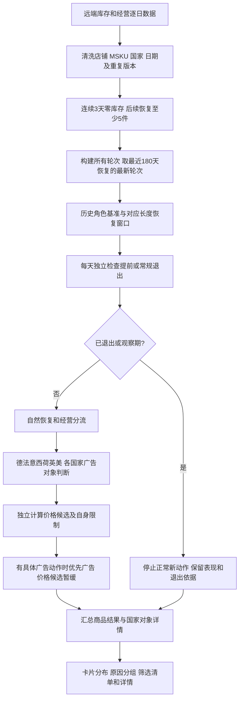

# 返场品页面数据开发交接总说明

**最终交接已整理至[正式交接入口](../正式交接/00-交接入口.md)。**新目录以结果数据表开发为目标，本文作为规则细则与来源参考保留。

交接日期：2026-10-10，最近更新：2026-10-12。现行规则版本：`return-v14-20261012-dynamic-price-visits`。

**交给新Codex时，从[给新Codex的开发任务](00-给新Codex的开发任务.md)开始。**该文件已写好开发目标和自动阅读顺序，用户无需逐份解释文档。

**最新交付范围：最终写入专用远端数据表，不做页面或路由。**以[数据表交付与落库要求](06-数据表交付与落库验收要求.md)和开工任务为准。下文关于页面、卡片、筛选和详情的内容，是现有规则及字段的来源参考，不是新开发交付项。

这份交接交付的是**复现现有页面数据判断所需的思路、规则、远端取数代码、计算代码、卡片统计代码和验收依据**。接手人不需要靠之前的聊天拼规则。本文不新增HTTP路由，也不交付执行广告、改价或预算划拨流程。

## 1. 先理解这个页面为什么这样做

返场不是商品永久标签，而是一次“确认断货—恢复库存—观察经营恢复—达标退出”的事件。页面要回答四件事：

1. 这次返场是怎么认定的，返场几天，观察还是干预阶段？
2. 恢复后的销量、订单毛利和销售角色怎么样，与断货前差多少？
3. 当前建议做什么，在哪个国家、哪个广告对象上调，调到多少？
4. 为什么仍未退出，什么条件已经满足，哪些条件仍有差距？

为避免反复出现“干预期就是必须调整”“价格升一档但实际先处理广告”“观察期广告无法判断”等误解，数据模型把以下四层分开：

| 层次 | 回答的问题 | 举例 |
| --- | --- | --- |
| 时间阶段 | 现在返场第几天 | D5观察期、D18干预期 |
| 经营判断 | 当前恢复怎么样 | 销量修复、恢复不足、利润风险 |
| 退出判断 | 这轮是否已经结束 | 未退出、D7稳定提前退出、连续达标常规退出 |
| 操作建议 | 目前有哪些具体候选动作 | 德国关键词提高竞价、法国保持价格、意大利调价受限 |

经营判断不代替具体动作；动作候选不代替完整达标；退出不以执行过动作作为前提。

## 2. 交接目录及阅读顺序

| 文件或目录 | 接手人要从中得到什么 |
| --- | --- |
| [最新运营策略思维导图](2026-10-10-返场品最新运营策略思维导图.xmind)及[文字大纲](2026-10-10-返场品最新运营策略思维导图说明.md) | 四张图串起进入退出、广告、国家调价和结果表交付；以2026-10-10现行规则重写 |
| [01-当前运营决策与进入退出规则](01-当前运营决策与进入退出规则.md) | 从进入到退出的完整运营规则、窗口、状态优先级、稳定性判断 |
| [02-远端取数与数据清洗开发文档](02-远端取数与数据清洗开发文档.md) | 每个指标读哪个远端表、用哪个字段、SQL参数、去重、缺数与历史日期处理 |
| [03-广告与调价决策代码对照](03-广告与调价决策代码对照.md) | 按代码真实顺序解释哪些可调广告、哪些可调价、目标金额、限制、待核公式 |
| [04-页面统计筛选与输出字段](04-页面统计筛选与输出字段.md) | 阶段分布、三步卡片、折叠原因、商品表格和详情怎样从结果计算 |
| [05-接手开发步骤与验收清单](05-接手开发步骤与验收清单.md) | 怎么运行代码、怎么接入批量任务、还缺什么、用哪些边界和真实案例验收 |
| [06-数据表交付与落库验收要求](06-数据表交付与落库验收要求.md) | 最终结果表、字段粒度、成功批次、幂等、退出留档和真实落库验收；最新交付范围 |
| [07-固定ACOS分档与广告调整规则](07-固定ACOS分档与广告调整规则.md) | 固定20%目标、50%上限、＋10%／＋3%／保持／−10%／−20%动作及库存、预算边界 |
| [11-零单广告点击分档简化规则](11-零单广告点击分档简化规则.md) | 零单统一按成熟点击分档：不足20保持、20—39降10%、40及以上降20% |
| [09-取消动作数量限制与涨降互斥规则](09-取消动作数量限制与涨降互斥规则.md) | 全部达标对象给建议，取消总动作及正向数量上限，同价格／竞价涨降互斥，资金及复评条件保留 |
| [12-降价动态访问门槛与对应窗口规则](12-降价动态访问门槛与对应窗口规则.md) | 断货前卖3件所需访问量、返场N／21／30窗口、预期与实际销量和缺项证据 |
| [代码使用说明](代码/代码使用说明.md) | 独立计算包的安装、配置、命令和函数调用 |
| `代码/return_goods_data/` | 完整进入、恢复、退出、广告、调价、远端取数及统计代码，无原项目导入依赖 |
| `代码/tests/` | 从当前实现提取的纯规则、数据展示与取数适配测试 |
| `样例与验收/` | 真实远端结果、远端字段核对、代码出处与校验清单 |
| [完整交接压缩包](2026-10-10-返场品页面数据开发交接.zip) | 本文件夹全部交付内容的打包副本，方便整体转交 |

## 3. 一条商品从数据到页面的完整路径



代码入口与这些步骤对应：

```python
histories = read_history(conn, store, msku, data_date, warnings)
listings, ladders, budgets = read_settings(conn, store, msku, settings_date)
ads = read_ads(conn, store, msku, data_date, settings_date, warnings)
for category, rows in histories.items():
    days = evaluation_days(rows)
    events = rules.build_events(days)
    # 完整代码还检查最近180天及最新事件边界。
    event = rules.evaluate_event(days, events[-1], data_date)
    summary, detail = enrich(event, (store, category, msku), rows,
                             listings, ladders, budgets, ads, data_date)
page_data = prepare_page_data(products, meta, all_rows=True)
```

## 4. 当前实现、远端交接包及未完成能力

| 内容 | 当前情况 |
| --- | --- |
| 当前页面计算 | 原项目有独立规则、计算批次、服务层和页面；部分业务数据由本机快照提供 |
| 本次交接包 | 全部业务查询改为完整远端库表名；纯规则与统计函数提取为独立Python包 |
| 页面统计 | 交接包附带`presentation.py`，可复现卡片、筛选、原因分组，不需要原FastAPI服务 |
| 源表修改 | 不修改；包内查询及连接会话均只读 |
| 财务核验 | 有单ACOS固定分档、零单20／40成熟点击分档已接入；零单不依赖每单成本或参考价格。真实池余额及正向动作调后预测利润仍需核验 |
| 结果持久化 | 交接包输出JSON，尚未替接手方选择数据库或完成全量批次发布 |
| 历史设置 | 远端存在当前表不代表存在每个历史日；缺历史价格／广告设置不借未来填充 |
| 参数效果 | 测试验证代码边界，不代表广告或价格运营收益已验证 |

交接包复制现行决策函数，不默默改变业务规则。发现的实现差异、限制与下一步开发项集中列在第05份文档；这是接手开发的工作清单。

## 5. 数据粒度必须保持

- 商品事件：店铺＋国家类别＋MSKU＋本轮断货首日＋恢复日。
- 国家建议：同一商品事件下的具体国家。
- 广告动作：国家＋profile＋活动＋广告组＋关键词或自动target。
- 数量卡片：按商品最新事件计数，同一商品同一分支只算一次。
- 建议详情：可以一个商品多国家、多广告对象、多条建议，不能把这些行数当商品数。

例如“审核升价208个”表示208个商品至少有一个国家的价格符合该展示分支，不表示208个商品所在国家类别的每个国家都提价。

## 6. 验证记录

交接包在自己的`代码/`目录运行，不依赖原项目包路径，隐藏后台测试结果见验收日志。真实远端样例来源为上一轮2026-10-10只读运行，业务日期分别为CJ057b的2026-10-08及GZ012a的2026-10-09，保留旧版规则，不作为新ACOS分档的全量数量或实跑结果。

本次同时提供代码来源校验清单，便于接手人核对复制函数是否与当前源一致。验证不代表远端缺失日期已经补齐，也不代表整个页面已经完成远端迁移。
