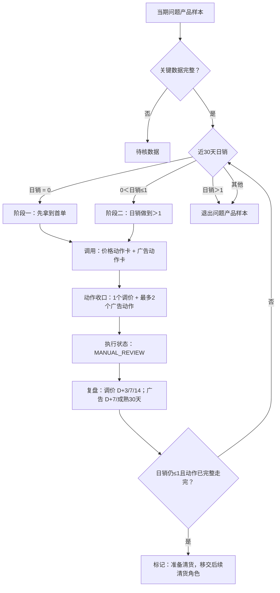

# 七国问题产品可复用运营决策框架

## 自动广告调整对象确认（2026-09-30）

本方案自动广告的升bid、降bid和零花费曝光测试，均以四种匹配方式对应的投放目标为对象：紧密匹配、宽泛匹配、同类商品、关联商品。每个目标分别判断，不以整个广告组作为这四种方式的竞价调整对象。此处只明确对象与取数口径，原有阈值、幅度、库存预算及审核条件继续适用。

- 唯一动作键为`profile_id + campaign_id + ad_group_id + target_id`。从`ods_datasync.lx_advertising_sp_targets`取实体，限定`expression_type='auto'`，以`expression`识别方式：`queryHighRelMatches`为紧密、`queryBroadRelMatches`为宽泛、`asinSubstituteRelated`为同类、`asinAccessoryRelated`为关联；未知类型待核。
- 当前有效竞价：目标`bid > 0`取自身值；目标`bid`为空或0时，按`profile_id + campaign_id + ad_group_id`关联`ods_datasync.lx_advertising_sp_ad_groups`，取同组有效`default_bid`。默认值也缺失或无效、关联不唯一时待核；不能把空值或0作为零出价。
- 点击、订单、花费和销售额取该目标自身同一成熟窗口的数据，并从汇总值计算ACOS、CVR。若用搜索词日报回卷，须去重、按完整目标键汇总，并核验归属、完整窗口、币种及与同组同窗数据对账。不能将广告组汇总复制或平均分配给四个目标；缺少可靠目标表现时不输出数值竞价建议。
- `dws_sp_search_term_analysis_daily.default_bid_current`只是广告组默认竞价。该表当前没有目标独立bid字段；`match_type`也不能直接当作四种自动方式。使用其target_id定位目标后，仍须取目标实体及有效竞价，不能沿用旧宽表建议。
- 建议价写到具体`target_id`，不修改广告组默认bid，也不把一个目标命中扩展成四种方式同时调整。继承默认bid的目标调整后设置目标独立bid；撤回时恢复原独立值或原继承状态，不将旧默认值固定为独立bid。
- 结果至少保存完整动作键、匹配方式及expression、目标原bid、组默认bid、有效bid及来源（own/group_default）、数据日期和成熟窗口、目标表现、规则码、建议bid、实际变化率及拦截原因。核验活动、组、目标启用和产品归属；不得用`object_type=ad_group`、缺失匹配方式的记录冒充目标级建议。

文档明确不代表生产生成逻辑已同步，须以结果中的目标标识、竞价来源和目标表现逐条验收。

## 毛利口径统一（2026-09-30确认）

问题产品、瘦狗产品和潜力产品的经营分流、调价、广告准入、路径切换及效果复盘统一使用**订单毛利率**。本文未单独限定的“毛利”“实际毛利”“margin”均指订单毛利率，不使用结算毛利率替代。

- 数据来自同一层、同一版本的产品表现日表；当前 DWD 为 `dwd_datasync.lx_statistics_product_performance`，订单毛利润字段为 `predict_gross_profit`，销售额字段为 `amount`。需要 ODS 复核时通过 `dwd.relate_id = ods.id` 对齐，不混拼两层金额。
- 经营分流使用最近完整 30 天：`订单毛利率 = sum(predict_gross_profit) / sum(amount)`；按国家＋店铺＋MSKU、同一窗口、同一币种汇总。日销为同窗口 `sum(volume) / 30`。
- 保留零销量日的订单毛利润及负值；不平均每日 `predict_gross_margin`，不再减一次广告费；`sum(amount) <= 0` 或必要数据缺失时输出待核，不当作零毛利率。
- 3/7/14 天等复盘保留原有窗口长度，但每个窗口均使用上述订单毛利率公式。阈值 5%/10% 等在计算中使用 0.05/0.10；标签 JSON 的百分数值须除以 100。
- `gross_profit`、`gross_margin` 属于结算口径，不参与本策略毛利判断；成本快照只用于成本项诊断，不能替代订单毛利率来源。P5/P10/P15/P20/P25/P30 等仍是定价模型价格线，不等于实际订单毛利率或调价后保证达到的毛利率。
- 本次统一毛利指标，不改变已确认的价格档位、调价幅度、库存、预算和历史动作约束；文档更新不代表生产计算已同步。

## 第一版交付范围（2026-09-21确认）

本期先完成问题产品的首轮动作建议：按当前最新可用数据筛选产品，判断调价及广告动作，输出具体对象、建议值、命中原因，或明确的无动作/待核原因。第一版不以完成后续运营复盘为前提。

- 只处理问题产品；数据库规则配置表暂不调整，130103保持不变。
- 先使用当前预算判断动作；符合下文无销量预算兜底条件时使用既定兜底额度。本期不生成新增预算或预算重分配建议。
- 执行记录由其他人员负责，不纳入本期开发与验收前置条件。输出人工审核建议不代表已执行，不自动操作广告平台。
- D+3/7/14复盘、效果评估、二轮调价、预算撤回及基于复盘的准备清货判断后置。正文相关章节保留为后续流程说明，不要求首版先完成。
- 条件及数据已明确的动作先产出；不明确的分支保留待核原因，不自行补阈值，也不阻塞其他已具备依据的动作分支。具体动作仍须通过适用的价格、预算、TACOS、对象效率及库存条件。
- 首版覆盖明细保留全部当期样本：有动作的给出建议，无动作的说明未命中或被阻断原因，不为凑齐动作强行调整。

本节限定第一版范围；正文关于每日重复执行、复盘及预算再分配的后续安排，不扩展本期交付范围。

## 1. 框架目的与边界

目标是先将问题产品的站点日销提升至 **大于 1**，而不是让每个问题产品都降价或加广告。低销量阶段，毛利只作为价格、广告和预算的安全护栏；销量达标后产品离开问题产品样本。若价格和广告动作已完整走完但日销仍未达标，则转为“准备清货”，移交后续清货角色处理。每次运行只对满足条件的站点 MSKU 输出有限、可核验的动作。

适用国家固定为 DE、FR、IT、ES、NL、UK、US。决策粒度固定为“国家 + 店铺 + MSKU”，不把店铺级标签、共享活动或跨 MSKU 归因直接拆到站点 MSKU。

本框架不保存或依赖历史固定名单。每次运行都按标签表**最新可用标签日 D**重新生成样本：

```text
标签 301（正常在售，current）按 店铺 + MSKU 命中
AND
标签 1304（站点问题产品，30d）按 国家 + 店铺 + MSKU 命中
AND
国家属于七国
```

当前最近一次运行的标签日为 2026-09-13，得到 2,118 条站点 MSKU。这只是本轮运行的样本数；下次的数量变化是正常的，不需要回填为旧名单。

## 2. 每轮运行的目标、指标与硬约束

### 2.1 目标指标

| 层级 | 指标 | 口径 | 用途 |
|---|---|---|---|
| 主目标 | 可售问题产品的 7 天日均销量 | 仅 FBA 可售大于 0、且动作前后均在样本内的站点 MSKU | 判断动作是否带来销量改善 |
| 驱动指标 | 同 MSKU 广告订单、CVR、ACOS、有效搜索词数 | 最近完整且归因成熟的 7 天窗口 | 判断广告动作该放大、维持还是收缩 |
| 去库存指标 | 可售库存、180 天以上库龄件数/金额、30 天销量 | 站点粒度 | 判断是否进入清库存分支 |
| 阶段目标 | 日销 | 最近完整 30 天销量 ÷ 30 | 首先达到日销 >1，退出低销量问题层级 |
| 失败转移 | 准备清货 | 价格和广告动作完成后的日销、价格底线与广告复盘状态 | 日销仍 ≤1 时移交后续清货角色 |

### 2.2 不可突破的约束

- 建议售价不得低于当天 `10% 毛利润价格（P10）`。
- 站点/国家广告总预算不得增加或突破；效果已验证的问题产品可在总预算内获得更多月/周预算，但必须来自已释放预算或总预算池未分配余额。预算余额必须扣除未来基础消耗，不能把“配置预算 - 已花”直接视作可加预算。
- 库存只参与补货、清库存与风险提示；不以 FBA 可售或断货状态拦截竞价上调、手动精准加词。预算和 TACOS 护栏仍必须通过。
- 价格、广告或库存任何关键字段缺失时，输出“待核数据”，不生成看似精确的数值动作。
- 价格已到 P10（或无有效降价空间）、价格 D+14 与广告成熟 30 天复盘已完成、日销仍 ≤1 时，停止新的销量动作并标记“准备清货”；系统不在本框架内直接清货或改成本。

## 3. 数据准备与质量闸门

每次运行自动读取各数据源的最新日期，并把日期写入输出。不同表的最新日期可不同；不把较旧的广告快照伪装为实时数据。

| 数据 | 主要用途 | 允许输出什么 |
|---|---|---|
| 标签表 | 生成当期问题产品样本 | 样本归属 |
| 在库节点定价表 | 当前价、P25、P20、P15、P10 | 调价建议和价格底线 |
| 站点经营指标 | 30 天销量、FBA可售/在途 | 日销分流与库存风险 |
| 产品广告预算表 + 广告日报 | 月/周预算、当期花费 | 预算上限和预算内重分配 |
| 当前 SP 实体 | 当前活动状态、广告组、关键词/投放对象、竞价 | 执行对象与当前 bid |
| 成熟广告表现和搜索词 | 点击、花费、同 MSKU 订单/销售额、保护标记 | 调竞价、加词、否词 |
| FBA 库存明细 | 断货历史、库龄 | 清库存、补货与库存风险提示 |

数据闸门分三档：

1. **可执行**：价格线、当前广告实体和成熟广告表现均完整，且预算/TACOS 护栏通过；库存状态单独作为风险提示。
2. **候选待复核**：方向可判断，但广告表现未成熟、广告映射不唯一、共享活动分摊不清，或当前花费未同步；只能给候选，不给执行数值。
3. **不动作/待数据**：P10/P25 异常、预算冲突、关键源过期或成本/汇率异常。FBA 为零只限制补货或清库存判断，不拦截广告路径。保留原因，下一轮自动重试。

## 4. 决策顺序：先分流，再动作

每条站点 MSKU 必须按以下顺序判断，前一层拦截时不进入后一层。



主图只负责分流和闭环，不重复展开价格、广告细则。阶段一和阶段二进入同一套动作卡：价格卡按 P25/P20/P15/P10 判断，广告卡按未开启、零花费、浪费、有效扩量判断；两者可以同日输出。日销 `≤1` 阶段始终以销量为主；日销 `>1` 时退出问题产品样本；价格和广告动作已完整走完、日销仍 `≤1` 时，才标记“准备清货”。

每条记录最多保留 **2 个主动作类别**：调价、广告、准备清货。广告属于一个主类别，但其中最多可含 2 个原子动作，例如“某关键词调 bid + 某搜索词否定”。这样避免一条产品同时堆叠多项无法归因的改动。

### 4.1 同日动作包：调价与广告不是串行关系

调价与广告的最小执行单位不是单个动作，而是一个**同日动作包**。系统在同一次运行中同时读取价格、广告、预算数据：先算建议价 `P'`，确认不低于 P10，再按广告预算、产品 TACOS 和广告对象表现组合调价和广告动作。它们不需要等待调价 D+7 没效果后才开始广告。

```text
同一数据快照
  → 计算建议价 P'
  → 校验 P' 不低于 P10
  → 选择广告动作（收缩或扩量）
  → 生成 1 个“调价 + 广告”动作包
  → 同一执行日审核、下发并记录生效时间
```

平台操作顺序是“先确认新价已在前台生效，再调整 bid/词”，但两者属于同一执行批次，不等待 3 天、7 天或 14 天的调价复盘。复盘起点 `T0` 取新价和广告动作都已生效后的较晚时间。

| 同日判断结果 | 动作包中的调价 | 动作包中的广告 | 说明 |
|---|---|---|---|
| `P>P10`；广告未开启 | 按 P25→P20→P15→P10 降到下一档 | 标记“广告未开启”，输出“开启广告”人工执行建议 | 价格先解决竞争力，广告开启是同一包内的待执行项，不等待价格复盘。 |
| `P>P10`；已开广告但 30 天无花费；预算、库存通过 | 按价格规则调价 | 当前有效对象 `bid +10%`，做 7 天曝光测试 | 用新价承接新增曝光，避免只降价却没有流量。 |
| `P>P10`；有广告花费但存在浪费 | 按价格规则调价 | 降 bid 和/或否词 | 同时改善价格竞争力与止损，不等待其中一项失败。 |
| `P>P10`；有有效广告对象，且 `TACOS<10%`、预算和对象级广告规则通过 | 按价格规则调价 | 涨 bid 和/或加精准词 | 同时测试“价格竞争力 + 有效流量”的组合效果。 |
| `P≤P10` | 不调价 | 仅执行广告动作 | 已没有自动降价空间，广告成为主动作。 |
| 价格已到 P10（或无有效降价空间）、价格 D+14 与广告成熟 30 天复盘已完成、日销仍 `≤1` | 停止新降价 | 停止新的扩量；可继续降 bid/否词 | 退出销量动作包，标记“准备清货”，移交后续清货角色。 |

每个动作包最多是 **1 个调价动作 + 2 个广告原子动作**。若同时存在风险收缩和扩量，先保留降 bid/否词，再保留涨 bid/加精准词；所有动作仍是 `MANUAL_REVIEW`，不直接写平台。

### 4.1.1 动作包的共同复盘

- **D+3**：看动作包是否带来日销/订单的早期改善，决定是否形成二次调价候选；不因 3 天广告 ACOS 波动立即加大动作。
- **D+7**：看动作包的日销是否仍未改善；价格无效果则执行二调，零花费曝光测试同步检查曝光、点击、花费和预算状态。
- **D+14**：复盘调价后销量、价格空间和广告成熟状态；日销仍未超过 1，则进入下一轮销量动作包或核验是否满足准备清货条件。
- **成熟 30 天**：复盘广告对象/搜索词效率；保留、替换或停止具体 bid、加词、否词动作。

因此，日销是否提升是动作包的共同结果指标；价格与广告的明细字段仍分别保留，只用于解释效果，不能把动作包拆回“先价格、后广告”的串行流程。

### 4.1.2 广告动作路由：连接动作包与第 6 节阈值

动作包中的“有浪费”“有效扩量”不是最终执行结论，只是广告入口状态。系统必须继续按广告对象类型路由到第 6 节的具体阈值，最终输出带有 `广告路径` 和 `规则来源` 的动作：

| 动作包内的广告状态 | 广告对象/来源 | 路由结果 | 调用规则 |
|---|---|---|---|
| 未开启 | 没有有效 SP 竞价对象 | `ad_not_enabled`：标记广告未开启，并输出“开启广告”建议 | 第 6.5 节 |
| 已开启、30 天无花费 | 当前有效自动对象或手动关键词 | `zero_spend_exposure`：满足预算、库存、模型利润时 bid +10% | 第 6.5 节 |
| 有花费、自动投放对象 | 自动投放的竞价对象 | `auto_bid`：根据点击、订单、ACOS、CVR 输出 bid 上/下调 | 第 6.2 节 |
| 有花费、自动来源搜索词 | 自动广告的自然语言搜索词 | `auto_negative`：零订单高点击时否词；或 `auto_to_exact`：满足条件时加手动精准 | 第 6.2、6.3 节；同词互斥 |
| 有花费、手动关键词 | 手动精准/词组/广泛关键词 | `manual_keyword`：根据点击、订单、ACOS 输出 bid 上/下调 | 第 6.3 节 |

路由完成后才应用统一护栏：降 bid、否词可直接保留；涨 bid、加精准词还要同时通过 `TACOS<10%`、预算和对象级广告规则。同一搜索词如果同时命中加精准和否词，否词优先；最终仍按“每产品最多 2 个广告原子动作”收口。

### 4.2 问题产品的销量分流

两类问题产品共用 P10、预算、TACOS 和动作上限，但首要动作不同；两类的共同阶段目标都是日销 >1。

| 分流 | 首要判断 | 首轮策略 | 毛利处理 |
|---|---|---|---|
| 日销 = 0 | 是否有有效广告实体、是否有花费、是否有曝光/点击 | 广告未开启时输出开启广告建议、零花费曝光测试、按价格阶梯判断调价、流量和转化排查 | 毛利不适用 |
| `0 < 日销 ≤ 1` 且订单毛利率 `<5%` | 是否存在无效广告消耗、当前价格档位、流量是否不足 | 仍以拉升销量为主：清无效广告、受控涨 bid/加词、必要时按 P25/P20/P15/P10 阶梯调价 | 毛利只作问题标签证据 |
| 日销 > 1 | 销量目标已达成 | 不再生成新的问题产品动作 | 下一次标签更新时退出问题产品样本 |
| 日销 `≤1` 且价格、广告动作均已完整复盘 | 销量动作已无下一步可执行空间 | 停止新调价和广告扩量 | 标记“准备清货”，移交后续清货角色 |

## 5. 调价规则

设当前价为 `P`，当天的 25%、20%、15%、10% 毛利润价格分别为 `P25`、`P20`、`P15`、`P10`。建议价按站点货币精度向上取整，取整后仍须低于现价且不低于 P10。

| 条件 | 首轮动作 | 复盘 |
|---|---|---|
| `P > P25` | 直接降至 `P25` | 进入 3/7/14 天复盘；不一次降到 P10 |
| `P20 < P ≤ P25` | 直接降至 `P20` | 进入 3/7/14 天复盘 |
| `P15 < P ≤ P20` | 直接降至 `P15` | 进入 3/7/14 天复盘 |
| `P10 < P ≤ P15` | 直接降至 `P10` | 进入 3/7/14 天复盘；P10 为最低档 |
| `P ≤ P10` | 不自动降价 | 检查广告、库存、链接/转化或成本 |
| P10/P15/P20/P25 缺失、倒挂或定价异常 | 待数据 | 不生成价格 |

价格动作与广告动作同日发生时，后续广告上限必须按建议价重算。守住 P10 是定价模型底线，不代表订单毛利率一定达标。

调价复盘固定为 **3 / 7 / 14 天**，从平台新价实际生效日开始计：

| 时点 | 判断 | 输出 |
|---|---|---|
| D+3 | 新价已生效，且 3 天日均销量未高于调价前同口径日均销量；零销量产品仍无订单，均视为“无早期效果” | 生成“二次调价候选”，不再等待满 7 天才开始准备 |
| D+7 | 仍无效果，且各档价格线与数据质量闸门均通过 | **进入二次调价审核**：以当时有效现价和最新价格线再降一档，最低 P10；当前首轮仅输出建议，不自动执行复盘动作 |
| D+14 | 比较调价前后同口径日均销量、广告消耗、价格空间和广告成熟状态 | 保留、停止后续降价，或核验是否转“准备清货” |

如果 D+3 已出现销量改善，则维持到 D+7 再判断，不提前二调；如果 D+7 时已到 P10、价格线异常或已标记准备清货，则不能继续降价，输出对应阻断原因。二次调价仍属于“调价”这一个主动作类别，不占用额外动作名额。

## 6. 广告规则：两条路径，统一护栏

广告不再使用一张混合阈值表。自动投放的“降浪费”与手动词的“扩量”是不同对象、不同精度的规则；它们共用同一产品级利润、TACOS、预算和复盘护栏。

### 6.1 共用范围、护栏与优先级

- 样本固定为最新标签日 `301 正常在售（current）∩1304 站点问题产品（30d）`，粒度为国家+店铺+MSKU，国家固定德国、法国、意大利、西班牙、荷兰、英国、美国。
- 角色来源使用 `dws_标签表汇总`；每轮保留标签日期和源表名。若标签汇总与旧标签表出现差异，标记数据差异后人工复核，不混用两表结果。
- 所有建议都只是 `MANUAL_REVIEW`，不直写广告平台；实体无效、MSKU 映射不唯一或成熟窗口缺失时，不给伪精确的执行数值。
- 产品级 TACOS：`≤5%` 正常放量；`>5%且<10%` 仅受控小幅放量；`≥10%` 不自动放量，只保留诊断、降 bid 或否词。
- 广告扩量统一受三道边界控制：产品 `TACOS<10%`、预算表仍有可用额度、并满足相应广告对象的点击/订单/ACOS/CVR 阈值。定价表只控制建议价不低于 P10，不再重复计算广告额度。
- 库存不作为涨 bid 或加精准词的阻断条件，只输出补货/断货/清库存风险。降 bid、否词、暂停建议也不受预算限制；涨 bid、加精准词必须通过预算引擎。
- 每个产品最多保留 2 个广告原子动作，排序为：否词/降 bid等风险收缩动作优先，其次才是涨 bid/加精准词的扩量动作。

### 6.2 自动广告路径：自动对象调 bid 与搜索词否词

对象为自动投放的竞价对象与其搜索词，使用归因成熟的 30 天表现。自动对象 bid 保留两位小数；因四舍五入无变化时，允许按最小单位 `±0.01` 修正，仍受平台下限/上限约束。

| 成熟 30 天表现 | 建议动作 |
|---|---|
| 0 单，点击 34–62 | bid −10% |
| 0 单，点击 ≥63 | bid −20% |
| 1 单，点击 34–62 且 ACOS>50% 或 CVR<3% | bid −5% |
| 1 单，点击 ≥63 | bid −10% |
| ≥2 单且 50%≤ACOS≤65% | bid −10% |
| ≥2 单且 ACOS>65% | bid −20% |
| ≥2 单、40%≤ACOS<50%、CVR<3% | bid −5% |
| 点击≥15、订单≥2、ACOS≤40%、CVR≥5%，且通过统一放量护栏 | bid +5% |
| 点击≥40、订单≥3、ACOS≤30%、CVR≥7%，且通过统一放量护栏 | bid +10% |
| 点击≥80、订单≥5、ACOS≤20%、CVR≥7%，且通过统一放量护栏 | bid +15% |

搜索词先做保护检查：有订单、保护数据不完整、品牌词、核心类目词或新品保护词均不自动否定。通过保护检查后，0 单且点击 49–62 输出“常规否词候选”；点击≥63 输出“高置信否词候选”。ASIN 输出否定商品投放，文字搜索词输出精准否定词；自有 ASIN 不自动否定。

### 6.3 手动扩量路径：手动关键词调 bid 与自动词加手动精准

手动关键词使用成熟 30 天表现，bid 保留两位小数；四舍五入后无差异即不动作，**不**用 `±0.01` 强制改价。

首版零单词只按归因成熟的 30 天点击数分档；点击或订单缺失时标记“待核数据”，不把缺失当作 0 单。`12` 和 `34` 次沿用本框架既有点击档位，并用 2026-09-21 最新标签日与广告快照核对：七国当期问题产品中，已映射、活动启用、有点击且零单的手动关键词共 785 个，点击 P50/P75/P90/P95 为 `3/7/15/24`；其中点击 `≥12` 有 109 个（约前 14%），`≥34` 有 21 个（约前 3%）。因此首版将较高点击零单词分两档止损；这只是样本分布依据，不代表降 bid 后销量改善已得到因果验证。

| 手动关键词成熟 30 天表现 | 建议动作 |
|---|---|
| ≥2 单，30%<ACOS<50% | bid −10% |
| ≥2 单，ACOS≥50% | bid −20% |
| 0 单、点击<12 | 继续观察 |
| 0 单、点击12–33 | bid −10% |
| 0 单、点击≥34 | bid −15% |
| 点击≥10、订单≥2、ACOS≤20%、TACOS≤5%，且预算护栏通过 | bid +10% |
| 点击≥10、订单≥2、ACOS≤20%、5%<TACOS<10%，且预算护栏通过 | bid +5% |

后续做潜力产品策略时，可研究“同国同类已成交关键词的平均每单广告花费”作为零单止损参照；须先核实可比样本并重新回测阈值，不将此前客单价的 20%/50% 直接沿用到首版。

自动来源的自然语言搜索词可加为专用手动精准词，但必须同时满足：自动广告来源、相关性通过、映射唯一、不存在同词有效手动精准、不与否词冲突、点击≥10、订单≥1、ACOS≤30%、产品 TACOS<10%，以及预算护栏。初始 bid 为 `min(来源 CPC, 每点击销售额 × 20%)`。加词后保留原自动词，不自动否定来源词；复盘将“原自动词+新精准词”的订单、销售额和花费合并，防止把流量迁移误判为净增长。

### 6.4 预算与互斥处理

**第一版预算口径：**先使用现有商品月/周预算与对应期间实际SP花费判断可用额度，不输出新增预算或预算重分配动作。下述无销量兜底用于预算判断，不直接修改广告平台预算，也不代表自动具备涨bid、加词或曝光测试资格。

无销量预算兜底沿用[手动关键词历史调价与自动搜索词加词决策第3.1节](../2026-09-16-问题产品手动关键词历史调价与自动搜索词加词决策.md)：

- 商品可按国家、店铺、MSKU安全匹配预算表，近30天销量为空或为0，且月预算或周预算为空或≤0时，采用日2欧元、周14欧元、月60欧元的既定兜底额度。月60欧元为固定额度，不随当月天数自动变化。
- 按预算快照中的最新欧元兑人民币汇率统一换算，再与人民币SP花费比较；适用于全部七国，不能把2欧元直接当作当地货币。
- 月花费取当月1日至最近完整自然日，周花费取本周周一至最近完整自然日，不用滚动30天花费替代月周累计。
- 启用该兜底时，不再要求商品总预算池和站点预算大于0；有销量但预算异常、预算表无法安全匹配或汇率不可用时，不使用兜底。
- 上述来源允许“销量为空”进入预算兜底判断，但这不等于将缺失销量补成0，也不替代产品样本、动作条件或数据完整性核验。零销售时TACOS未定义仍保留待核，不因获得兜底额度自动按TACOS=0放量。

以下预算再分配公式与复盘安排保留为后续阶段说明，不作为本期新增预算动作：

预算调整是**内部再分配**，不是新增总预算。站点/国家总预算保持不变；效果已验证的问题产品可以从已释放预算或总预算池未分配余额中获得更多月/周预算。共享活动只输出 MSKU 建议分配额和关联产品，不能单凭一个 MSKU 直接上调整个活动日预算。

```text
月可新增额 = 月预算余额 − 预计未来基础消耗
周可新增额 = 周预算余额 − 预计未来基础消耗
可再分配池 = 释放预算 + 总预算池未分配余额
B_test = min(月可新增额, 周可新增额, 可再分配池, 月配置预算 × 10%, 周配置预算 × 25%)
```

| 产品状态 | 预算动作 |
|---|---|
| 30 天已有广告花费和成熟订单，产品 `TACOS≤5%`，对象级规则也支持扩量 | 可增加月/周预算，最高为 `B_test`。 |
| `5%<TACOS<10%`，对象级规则支持扩量 | 仅受控增加，最高为 `B_test × 50%`。 |
| `TACOS≥10%`、没有成熟订单、或已开启但 30 天无花费 | 不增加预算；零花费产品先走第 6.5 节曝光测试。 |
| D+7 日销未改善或 TACOS 恶化 | 撤回本轮新增预算，回流至可再分配池。 |

释放预算的来源优先级为：无效对象降 bid/否词释放的预算 → 同产品低效活动预算 → 同站点低效问题产品的未使用预算 → 总预算池未分配余额。同一个搜索词不得同时输出“加手动精准”和“否词”；发生冲突时，否词优先，另一个动作记录为被互斥拦截。预算状态缺失或共享活动未完成关联产品核验时，涨 bid、加精准词和预算增加都转人工，但降 bid、否词继续输出。

### 6.5 零广告花费：先识别未开启，再做受控曝光测试

产品 30 天广告花费为 0 时，不按“ACOS=0、可直接放量”处理，必须先分流：

| 广告实体状态 | 预算/库存状态 | 输出 |
|---|---|---|
| 未发现有效 SP 竞价对象 | 不适用 | `广告未开启`；输出“开启广告”人工执行建议。无结构时新建，有停用结构时核验后启用；不得把映射缺失误判为未开启 |
| 已开启实体，但 30 天广告花费为 0 | 预算或库存不满足 | `已开启但无花费`，保留预算受限/库存不足原因，不提高 bid |
| 已开启实体，但 30 天广告花费为 0 | 预算充足、库存充足 | 对当前有效对象做一次 `bid +10%` 曝光测试，标记 `exposure_test=true`，7 天复盘曝光、点击、花费与预算状态 |

这条“零花费曝光测试”是库存参与广告判断的唯一场景：它避免给无法承接销量的断货产品主动拉新曝光。它不改变常规有效词扩量的规则；已有花费且通过 TACOS/预算护栏的涨 bid、加精准词仍不以库存作为拦截条件。

### 6.6 与调价、清货准备复盘的衔接

同日调价时，只校验建议价不低于 P10；广告扩量继续按预算、产品 TACOS 和广告对象规则判断。调价 D+3 只形成二调候选，D+7 仍无效果才执行二调，D+14 汇总结果；广告则在第 7 天做风险检查、在成熟 30 天完成完整复盘，两者分别记录，不混作同一个效果结论。若价格已到 P10（或无有效降价空间）、价格 D+14 与广告成熟 30 天复盘均完成、日销仍未超过 1，则停止新的放量和降价，标记“准备清货”，移交后续清货角色。

## 7. 库存与清货准备

### 7.1 库存分层与约束

库存使用 FBA 可售和 30 天销量计算，不用“有库存/没库存”的主观判断：

```text
DOS = FBA 可售 ÷ max(30 天销量 ÷ 30, 0.1)
```

| 库存层级 | 判定阈值 | 调价与广告处理 |
|---|---|---|
| 断货 | FBA 可售 = 0 | 标记断货；不做价格效果测试、不做零花费曝光测试；已有广告仍可降 bid、否词。常规有效词涨 bid/加精准词不因库存字段被系统硬拦截，但必须保留断货风险标记。 |
| 紧张 | `0<DOS≤7` | 不增加活动预算；可执行降 bid、否词及通过其他护栏的常规 bid 调整；标记补货优先。 |
| 测试库存 | `7<DOS≤28` | 允许预算内广告测试和同日调价；新增预算最多使用第 6.4 节的常规 `B_test`。 |
| 健康库存 | `28<DOS≤90` | 正常执行调价和广告规则。 |
| 高库存 | `DOS>90`，或 180 天以上库龄件数占可售 `≥30%` | 进入清库存路径；预算测试上限可使用月预算 15%、周预算 30%，但不突破余额、P10 和产品 TACOS 10%。 |

30 天销量为 0 时，DOS 只用于提示“无销量高库存”，不自动等同于库存充足；是否启动曝光测试仍要求 FBA 可售大于 0 且预算状态充足。

### 7.2 准备清货

“准备清货”不是立即降到最低价或自动清仓，而是问题产品框架的失败转移状态，交给后续清货角色继续处理。必须同时满足：

1. 价格已到 P10，或定价表确认没有有效降价空间；
2. 至少已执行一轮同日动作包，价格 D+14 复盘完成；
3. 广告成熟 30 天复盘完成，且没有新的有效扩量动作可执行；
4. 日销仍 `≤1`。

输出字段为“准备清货”和对应证据（P10 状态、调价复盘、广告复盘、日销、库存/DOS、库龄）。后续清货角色再决定是否做库存处置、促销或其他清货动作；本框架不直接执行这些动作。

## 8. 输出、执行与复盘

### 8.1 每条输出字段

`运行日期、标签日、角色源表、国家、店铺、MSKU、30天销量、广告30天花费及广告状态、FBA可售/在途/库龄、DOS及库存层级、当前价、P25、P10、建议价、广告路径、规则来源、对象类型、当前bid、成熟30天点击/花费/同MSKU订单/销售额/ACOS/CVR、产品TACOS状态、月/周预算与预算状态、可新增额、加词/否词、搜索词互斥校验、原自动词+新精准词合计复盘、被拦截原因、主动作1、主动作2、执行状态(MANUAL_REVIEW)、D+3二调候选、D+7二调结论、D+14复盘结论、准备清货状态与证据、数据问题`。

### 8.2 运行节奏

| 节奏 | 自动产出 | 人工决策 |
|---|---|---|
| 每日 | 重新生成最新标签样本、更新价格/库存/预算/广告数据质量 | 审核异常数据与库存风险 |
| 每周 | 生成可执行动作卡和候选待复核卡 | 执行审核通过的价格、bid、词、预算变更 |
| 调价后 3 天 | 新价是否已生效、3天日均销量、订单和库存 | 无早期效果即生成二调候选；有改善则继续观察 |
| 调价后 7 天 | 同口径日均销量、同MSKU订单、CPA/ACOS、库存与预算停止条件 | 仍无效果则直接执行二调；有改善则维持 |
| 调价后 14 天 | 同口径日均销量、价格复盘与广告成熟状态 | 判断有效、准备下一轮动作包，或在满足清货准备条件时移交后续清货角色 |
| 每月 | 固定样本的销量、毛利、去库存金额、无动作对照 | 校准点击阈值、调整幅度和预算测试比例 |

系统永远允许输出“不动作”。这是正确结果，不是漏判：例如已到 P10、广告证据不足或利润口径未成熟时，强行调整只会制造不可解释的风险。

## 9. 当前实现状态

`scripts/export_problem_product_decision_base.py` 自动读取各源最新日期，不写死标签、定价、预算或广告快照日期；角色样本切换为 `dws_标签表汇总`。`scripts/problem_product_ad_rules.py` 已将本章的四类对象规则固化为纯规则层：自动对象 bid、手动关键词 bid、自动词加手动精准、自动搜索词否词，并负责同词互斥和每产品最多两条广告动作。该规则层只输出 `MANUAL_REVIEW`，不调用广告平台接口；数据源未成熟或关键字段缺失时保留阻断原因，不输出伪精确动作。
